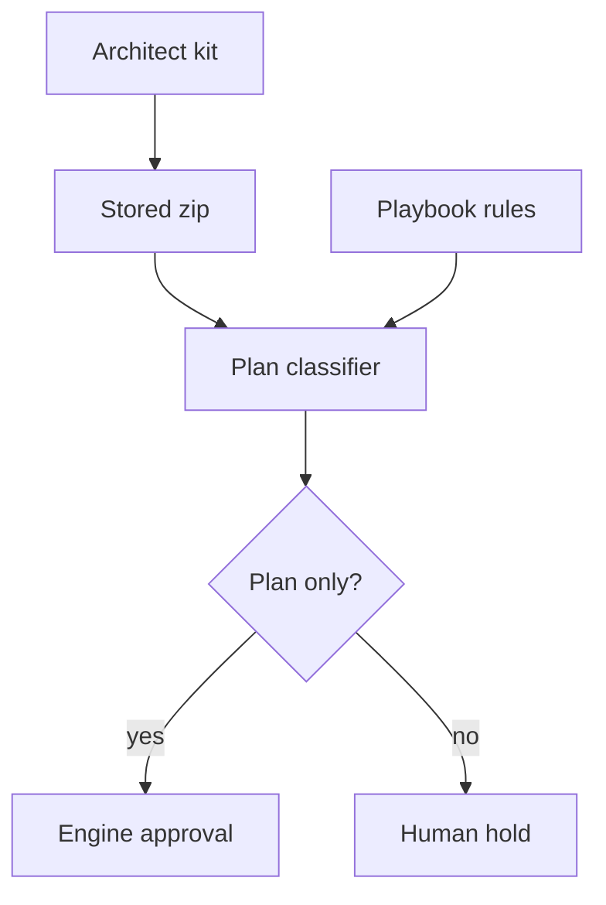

<h3>PR Summary by Qodo</h3>

Restrict autonomous kit applies and guard reviewed PR merges

<code>🐞 Bug fix</code> <code>✨ Enhancement</code> <code>📝 Documentation</code> <code>🧪 Tests</code> <code>🕐 40+ Minutes</code>

AI Description

<dl>
<dd>
 

><pre>
>• Restrict autonomous architect-kit approval to plan files, so other changes require human approval.
>• Prevent review races by checking branch heads and matching the reviewed commit at merge.
>• Clarify apply and review failure paths, with tests and operator guidance.
></pre>

</dd>
</dl>

Diagram

<dl>
<dd>

 

</dd>
</dl>

High-Level Assessment

<dl>
<dd>

 

>Keep the plan-file allowlist rather than extending the previous CI-file denylist: gate inputs extend beyond the known CI paths. Reusing the repository playbook&#x27;s send prompts also protects named review files without maintaining a second path list. The guarded merge and branch-head check address different points in the review race, so both belong in the protocol.

</dd>
</dl>

 Files changed (30) <code> +1461 / -529 </code> 

<dl>
<dd>

 

Enhancement (2) <code> +89 / -45 </code>

<dl>
<dd>

playbook.py<code>Hold non-plan autonomous applies for the owner</code> <code>+50/-26</code>

 

>Hold non-plan autonomous applies for the owner
>
><pre>
>• Replaces the CI-specific hold with plan-file classification of stored kits. Retains the playbook-specific reason when a kit carries the playbook and publishes the new owner reason otherwise.
></pre>
>
><a href='https://github.com/SigorMatt/hands/pull/10/files#diff-d4c45908377a317f0fbbccad6f8af7a74c4af564c4272d3cecc7126bf1be9204'>src/hands/playbook.py</a>

spool.py<code>Classify stored kit files against a plan allowlist</code> <code>+39/-19</code>

 

>Classify stored kit files against a plan allowlist
>
><pre>
>• Adds exact-case plan-file classification and sorted stored-zip file enumeration. Removes the CI-only entry classifier.
></pre>
>
><a href='https://github.com/SigorMatt/hands/pull/10/files#diff-afef6fe420dcdc67164710839c508470d94b5a42c23284c4d8cbca7fe9a71221'>src/hands/spool.py</a>

</dd>
</dl>

Bug fix (4) <code> +299 / -96 </code>

<dl>
<dd>

REVIEW-PROTOCOL.md<code>Guard merges and preserve review failure outcomes</code> <code>+94/-26</code>

 

>Guard merges and preserve review failure outcomes
>
><pre>
>• Requires a branch-head check before committing a PR review and a head-matched merge. Defines moved-branch, failed-push, missing-PR, failed-rules, and failed-merge handling; classifies defects and restores main after branch reviews.
></pre>
>
><a href='https://github.com/SigorMatt/hands/pull/10/files#diff-d136b4ee2cca075a1117349d23c7a4be93a3bd39bc5aaad31471473f17afa8cf'>meta/REVIEW-PROTOCOL.md</a>

config.py<code>Report allowed repository main settings for every invalid type</code> <code>+21/-8</code>

 

>Report allowed repository main settings for every invalid type
>
><pre>
>• Adds choice validation so invalid strings and non-string values all produce an error naming both permitted settings.
></pre>
>
><a href='https://github.com/SigorMatt/hands/pull/10/files#diff-bee58eb7fec766fa3b7a3615f745a974c94fd209b85d819fc80e50315ea5dd93'>src/hands/config.py</a>

kit.py<code>Warn on non-plan kit entries</code> <code>+90/-36</code>

 

>Warn on non-plan kit entries
>
><pre>
>• Excludes main from apply prompt case (b). Derives paths named by playbook send rules and replaces CI-specific kit-check warnings and JSON output with owner warnings for non-plan files.
></pre>
>
><a href='https://github.com/SigorMatt/hands/pull/10/files#diff-c741f63d4fccb12bbfc566ee658f6a10d5d610c9e09e4a336f11292aaa5c1b37'>src/hands/kit.py</a>

REVIEW-PROTOCOL.md<code>Apply guarded review rules to future missions</code> <code>+94/-26</code>

 

>Apply guarded review rules to future missions
>
><pre>
>• Mirrors the repository review protocol&#x27;s head checks, merge guard, defect dispositions, failure-path commits, and return-to-main rule.
></pre>
>
><a href='https://github.com/SigorMatt/hands/pull/10/files#diff-1a13ad1e2168d9dd38e2e3f07712fc77e6d7bbef5b55f45f54dbd1737103bfb6'>templates/REVIEW-PROTOCOL.md</a>

</dd>
</dl>

Tests (12) <code> +704 / -228 </code>

<dl>
<dd>

harness.py<code>Keep named review protocols in test repositories</code> <code>+10/-7</code>

 

>Keep named review protocols in test repositories
>
><pre>
>• Removes the review protocol from the plan-only kit fixture because a send rule names it.
></pre>
>
><a href='https://github.com/SigorMatt/hands/pull/10/files#diff-37bf99e6f6951b9ee58a2ae68876ad147128c70c830eab6ff249012da01d20fd'>tests/harness.py</a>

test_apply_not_landed.py<code>Retire CI-only hold tests</code> <code>+5/-192</code>

 

>Retire CI-only hold tests
>
><pre>
>• Removes tests for the superseded CI-only classification and warning behavior; the replacement coverage lives in test_plan_files.py.
></pre>
>
><a href='https://github.com/SigorMatt/hands/pull/10/files#diff-75fd6ebd2bdcd0692323a9e9ac2460701097788001a3c31ce33bca1f92b9de3c'>tests/test_apply_not_landed.py</a>

test_apply_shape.py<code>Pin the corrected pull-request apply prompt</code> <code>+40/-8</code>

 

>Pin the corrected pull-request apply prompt
>
><pre>
>• Builds the expected prompt from the design&#x27;s replacement case (b) and checks that it excludes main.
></pre>
>
><a href='https://github.com/SigorMatt/hands/pull/10/files#diff-5fd910485996cf07749dd89b3e2384cfbe22407c5b1752eed8903c1618acc46d'>tests/test_apply_shape.py</a>

test_config.py<code>Test invalid repository main types</code> <code>+20/-1</code>

 

>Test invalid repository main types
>
><pre>
>• Checks that boolean, integer, and unsupported string values produce errors naming both valid settings.
></pre>
>
><a href='https://github.com/SigorMatt/hands/pull/10/files#diff-da24b355349b53e4c8047034767d008e4c2ce9ea6c8933a3acd50d0828f00528'>tests/test_config.py</a>

test_consult.py<code>Commit the review protocol in consultation fixtures</code> <code>+3/-0</code>

 

>Commit the review protocol in consultation fixtures
>
><pre>
>• Places the send-rule-named protocol in the test repository rather than relying on a kit to carry it.
></pre>
>
><a href='https://github.com/SigorMatt/hands/pull/10/files#diff-7131a9d0f5d0c3b813bf1bc7a3386bd4956b37878d1fab73bf9d531768d9d2ea'>tests/test_consult.py</a>

test_docs.py<code>Pin the head-matched handbook merge command</code> <code>+2/-1</code>

 

>Pin the head-matched handbook merge command
>
><pre>
>• Updates the handbook assertion to require the reviewed-head merge option.
></pre>
>
><a href='https://github.com/SigorMatt/hands/pull/10/files#diff-5c6dddc0c85981eb75bdb49d400e82c9271918e138990baba53ac34cbcf2aaac'>tests/test_docs.py</a>

test_docs_45.py<code>Align earlier documentation pins with the new rules</code> <code>+26/-9</code>

 

>Align earlier documentation pins with the new rules
>
><pre>
>• Updates checks for missing-PR review placement and the architect&#x27;s plan-only kit instructions.
></pre>
>
><a href='https://github.com/SigorMatt/hands/pull/10/files#diff-23cc26d9a9059fac4d8b4b4fba07516cb5d26b20b9f240270e440ead372caa42'>tests/test_docs_45.py</a>

test_docs_46.py<code>Pin review protocol and handbook safeguards</code> <code>+254/-0</code>

 

>Pin review protocol and handbook safeguards
>
><pre>
>• Adds text assertions for both protocol copies, the builder template, and handbook coverage of moved heads, failure paths, defect dispositions, and merge guards.
></pre>
>
><a href='https://github.com/SigorMatt/hands/pull/10/files#diff-17068ab1a2c875846451ffd25a044740ab9df4e19c69947dc574099ad4c841bb'>tests/test_docs_46.py</a>

test_kit.py<code>Require guarded merges in the protocol template</code> <code>+2/-1</code>

 

>Require guarded merges in the protocol template
>
><pre>
>• Updates the template assertion to expect a merge command that matches the reviewed head.
></pre>
>
><a href='https://github.com/SigorMatt/hands/pull/10/files#diff-b3958ae2feb00d9e16b26db0a3af497629df71b4db8d583f8178a4c74fa901d3'>tests/test_kit.py</a>

test_operator_table.py<code>Pin the new owner-hold operator reason</code> <code>+6/-4</code>

 

>Pin the new owner-hold operator reason
>
><pre>
>• Replaces CI-specific reason expectations with the plan-files hold reason in operator-table checks.
></pre>
>
><a href='https://github.com/SigorMatt/hands/pull/10/files#diff-9cb3db68dbfe38e0f721592b1254b54bbead87e66798bf88ee11c1c23175e922'>tests/test_operator_table.py</a>

test_plan_files.py<code>Test plan-file approval and owner holds</code> <code>+325/-0</code>

 

>Test plan-file approval and owner holds
>
><pre>
>• Covers exact-case classification, automatic approval, human holds, reason precedence, warnings and JSON output, and phone-mode behavior.
></pre>
>
><a href='https://github.com/SigorMatt/hands/pull/10/files#diff-5e252f16a8bbb77eae071ebbac116e7a14e22f8c8478b5c450b85beaa3f8fe49'>tests/test_plan_files.py</a>

test_playbook.py<code>Update autonomous playbook fixtures and expectations</code> <code>+11/-5</code>

 

>Update autonomous playbook fixtures and expectations
>
><pre>
>• Commits the named review protocol to the test repository and expects a non-plan configured-path entry to be held rather than approved.
></pre>
>
><a href='https://github.com/SigorMatt/hands/pull/10/files#diff-00966bca5744c3edcaf16252d9a9e5dbe092f5f76422c5357077b91f27f001dc'>tests/test_playbook.py</a>

</dd>
</dl>

Documentation (12) <code> +369 / -160 </code>

<dl>
<dd>

CLAUDE.md<code>Limit architect kits to plan files</code> <code>+16/-14</code>

 

>Limit architect kits to plan files
>
><pre>
>• Directs the architect to escalate when a kit would need code, tests, configuration, or another non-plan file. Adds that condition to the escalation rule.
></pre>
>
><a href='https://github.com/SigorMatt/hands/pull/10/files#diff-c7481d712d315e34b3da6aac27aaebe24ec06bb80ebb35f3c1c5e073b561920e'>architect/CLAUDE.md</a>

ARCHITECT-HANDBOOK.md<code>Document plan-file ownership and guarded reviews</code> <code>+104/-26</code>

 

>Document plan-file ownership and guarded reviews
>
><pre>
>• Explains the new kit hold and operator response. Documents reviewed-head matching, review failure paths, defect dispositions, and returning the tree to main.
></pre>
>
><a href='https://github.com/SigorMatt/hands/pull/10/files#diff-2ad26343d21a57c4b0e1450bc61bad64fd9ee975037b345cdcf9841cdab2905e'>docs/ARCHITECT-HANDBOOK.md</a>

INTEGRATION.md<code>Clarify the scope of autonomous approval</code> <code>+8/-1</code>

 

>Clarify the scope of autonomous approval
>
><pre>
>• Explains which plan files receive standing approval and why other architect-filed kits wait for the owner.
></pre>
>
><a href='https://github.com/SigorMatt/hands/pull/10/files#diff-9610d0a1913600337b4a1fb10a0a3ca941655e61137a7e2ee493dfec6c622d99'>docs/INTEGRATION.md</a>

PLAYBOOK.md<code>Describe the plan-only playbook rule</code> <code>+11/-0</code>

 

>Describe the plan-only playbook rule
>
><pre>
>• Documents automatic approval, owner holds, and warnings for non-plan entries under an autonomous architect playbook.
></pre>
>
><a href='https://github.com/SigorMatt/hands/pull/10/files#diff-2caab8322fd895d19c2c0aeb1e9d4d48abe9a134afd0ade65bdb75b661a8eff0'>docs/PLAYBOOK.md</a>

CHECKPOINT.md<code>Record mission 30 progress</code> <code>+39/-67</code>

 

>Record mission 30 progress
>
><pre>
>• Replaces the prior mission checkpoint with unit results, test counts, unresolved live-verification limits, and standing constraints.
></pre>
>
><a href='https://github.com/SigorMatt/hands/pull/10/files#diff-ea6fe37f51c315b66c5f700d302e82876099d5e56dca9614d58d4db344903b78'>meta/CHECKPOINT.md</a>

FINAL-REPORT-30.md<code>Add the mission 30 final report</code> <code>+90/-0</code>

 

>Add the mission 30 final report
>
><pre>
>• Summarizes unit changes, tests, unproven live behavior, deviations, and closure of review findings.
></pre>
>
><a href='https://github.com/SigorMatt/hands/pull/10/files#diff-2acf048097838bfba4b5759f69186b5fd7f3eee8e9630235ac9af662601f1f8e'>meta/FINAL-REPORT-30.md</a>

FINDINGS.md<code>Resolve gate follow-up findings</code> <code>+42/-4</code>

 

>Resolve gate follow-up findings
>
><pre>
>• Records the resolution of H-081 through H-083 and files and resolves H-084 and H-085 for review-file placement and branch cleanup.
></pre>
>
><a href='https://github.com/SigorMatt/hands/pull/10/files#diff-15d0d274f2f7c3edd933310939b6c0581b53648f48d23f2039cca510e9aa21cd'>meta/findings/FINDINGS.md</a>

journal.md<code>Log mission 30 units</code> <code>+5/-0</code>

 

>Log mission 30 units
>
><pre>
>• Adds the mission&#x27;s unit outcomes, gate counts, and remaining live-verification limits.
></pre>
>
><a href='https://github.com/SigorMatt/hands/pull/10/files#diff-9f0a1b37813ca47db6195fa5c6e69a32efcef6da121060bbd5f1d558be1cbeda'>meta/journal.md</a>

plan.md<code>Plan the gate follow-up mission</code> <code>+40/-43</code>

 

>Plan the gate follow-up mission
>
><pre>
>• Replaces the mission 29 plan with mission 30 units, finding assignments, dependencies, and exclusions.
></pre>
>
><a href='https://github.com/SigorMatt/hands/pull/10/files#diff-7b1c6ea9ab4fd6179a8304348a94fbf1fa61cfb6aafed7ec549bcd7b7f8df461'>meta/plan.md</a>

BUILDER-N-PROMPT.md<code>Tell builders that confirmed PR defects block merge</code> <code>+4/-1</code>

 

>Tell builders that confirmed PR defects block merge
>
><pre>
>• Adds the blocker rule after the existing instruction to file findings requiring design decisions.
></pre>
>
><a href='https://github.com/SigorMatt/hands/pull/10/files#diff-4abca313f3571f857a4d82f471a44d49fcb38a568dba8775b9e3aa7e82e30dca'>templates/BUILDER-N-PROMPT.md</a>

PLAYBOOK-missions.toml<code>Explain plan-only approval in the mission template</code> <code>+5/-3</code>

 

>Explain plan-only approval in the mission template
>
><pre>
>• Clarifies that autonomous standing approval covers plan-file kits, not other files or playbook changes.
></pre>
>
><a href='https://github.com/SigorMatt/hands/pull/10/files#diff-71de6399d2c01ab7f8e4d3f9b1661209039a1636d415e6c9ca3b9713eb06c4e6'>templates/PLAYBOOK-missions.toml</a>

PLAYBOOK-runs.toml<code>Explain plan-only approval in the runs template</code> <code>+5/-1</code>

 

>Explain plan-only approval in the runs template
>
><pre>
>• Adds the same owner-approval boundary to the runs playbook guidance.
></pre>
>
><a href='https://github.com/SigorMatt/hands/pull/10/files#diff-6b7afdbf7f7f50198efe8af64247cddd0cc24f62e63089e7b21b8045686a99c4'>templates/PLAYBOOK-runs.toml</a>

</dd>
</dl>

</dd>
</dl>

