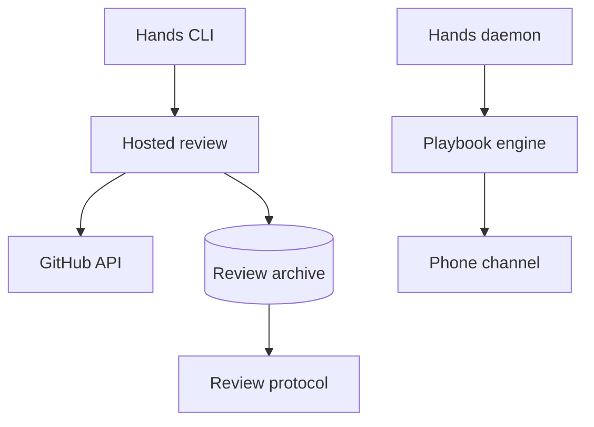

<h3>PR Summary by Qodo</h3>

Add mechanical hosted-review reading and resolve mission 22 findings

<code>🐞 Bug fix</code> <code>✨ Enhancement</code> <code>🧪 Tests</code> <code>📝 Documentation</code> <code>⚙️ Configuration changes</code> <code>🕐 40+ Minutes</code>

AI Description

<dl>
<dd>
 

><pre>
>• Add a hosted-review command that archives bot comments and detects findings edited in place.
>• Fix review recovery, phone commands, job IDs, project setup, and architect handbook access.
>• Align builder and reviewer protocols with the new workflow and add regression coverage.
></pre>

</dd>
</dl>

Diagram

<dl>
<dd>

 

</dd>
</dl>

High-Level Assessment

<dl>
<dd>

 

>The following are alternative approaches to this PR:

<b>1. Stage review snapshots before publishing them</b>

<dl>
<dd>

- ➕ An archive-write failure would not leave an incomplete numbered snapshot that a later run treats as its predecessor.
- ➖ Requires temporary-directory handling and atomic promotion, adding complexity to a command that already fetches all pages before writing.

</dd>
</dl>

>**Recommendation:** Keep the explicit paginated fetch and Code Review comment as the verdict source: both match the documented bot behavior, including in-place edits. Consider atomic snapshot publication before relying on the archive as durable review evidence; the current command creates its numbered directory before writing every file.

</dd>
</dl>

 Files changed (51) <code> +3544 / -318 </code> 

<dl>
<dd>

 

Enhancement (4) <code> +444 / -19 </code>

<dl>
<dd>

bash_guard.py<code>Allow architect reads of installed hands documentation</code> <code>+27/-16</code>

 

>Allow architect reads of installed hands documentation
>
><pre>
>• Adds &#x27;HANDS_DOCS&#x27; as an architect-only read root and permits architect-mode &#x27;hands handbook&#x27;. Driver-mode access remains restricted.
></pre>
>
><a href='https://github.com/SigorMatt/hands/pull/4/files#diff-19f2ab92dd12e6110ca94a59853d99703e4636cababa636d2003000b7b53a974'>driver/hooks/bash_guard.py</a>

cli.py<code>Expose the hosted-review command</code> <code>+25/-3</code>

 

>Expose the hosted-review command
>
><pre>
>• Adds &#x27;hands hosted-review &lt;pr&gt; [--bot]&#x27; as a client-side command and clarifies installed handbook help text.
></pre>
>
><a href='https://github.com/SigorMatt/hands/pull/4/files#diff-b53aaafe941dad7529e17dc5ad20b86fb13177f2778fbe0547c019ca0c4c8ce4'>src/hands/cli.py</a>

hosted.py<code>Fetch, archive, and interpret hosted bot reviews</code> <code>+389/-0</code>

 

>Fetch, archive, and interpret hosted bot reviews
>
><pre>
>• Fetches every page of three GitHub comment sources through &#x27;gh&#x27;, filters by bot, and archives numbered snapshots. Reports categories, anchored findings, in-place edits, and a verdict from the Code Review issue comment; an absent bot comment exits as not-yet-reviewed.
></pre>
>
><a href='https://github.com/SigorMatt/hands/pull/4/files#diff-12a5dbbc969c160015a0fe085926cb598038c83131b13d5d84d1da86343eed7e'>src/hands/hosted.py</a>

notify.py<code>Make held job IDs easy to copy</code> <code>+3/-0</code>

 

>Make held job IDs easy to copy
>
><pre>
>• Prints a held job&#x27;s ID on its own line in the notification body.
></pre>
>
><a href='https://github.com/SigorMatt/hands/pull/4/files#diff-af3a0aa2537d036af0f455917e05d4e16b24196d24cdaa3a103eb570dd2eeff2'>src/hands/notify.py</a>

</dd>
</dl>

Bug fix (8) <code> +422 / -119 </code>

<dl>
<dd>

settings.json<code>Run the background guard with isolated Python</code> <code>+1/-1</code>

 

>Run the background guard with isolated Python
>
><pre>
>• Adds &#x27;-I&#x27; to the no-background hook command so modules planted beside the hook cannot override its imports.
></pre>
>
><a href='https://github.com/SigorMatt/hands/pull/4/files#diff-f27ac6f39d89fe021c56900069198aa7d9968f2cd6645c00b11ffd1b78fcf546'>.claude/settings.json</a>

PLAYBOOK.toml<code>Resume reviews orphaned by daemon restarts</code> <code>+6/-0</code>

 

>Resume reviews orphaned by daemon restarts
>
><pre>
>• Adds an &#x27;aux.orphaned&#x27; resume rule to the repository playbook.
></pre>
>
><a href='https://github.com/SigorMatt/hands/pull/4/files#diff-911e9e17c8e848de27e97f48743e5cb246052623890da97deb702bbdc5374ae3'>PLAYBOOK.toml</a>

api.py<code>Accept human-friendly IDs and locate root checkpoints</code> <code>+85/-5</code>

 

>Accept human-friendly IDs and locate root checkpoints
>
><pre>
>• Resolves exact or unique normalized job IDs for decisions and cancellation, and reads progress checkpoints from the builder repository root. Builder answers and CLI sends also receive a dirty-journal reminder when needed.
></pre>
>
><a href='https://github.com/SigorMatt/hands/pull/4/files#diff-16f021e493ba18b1e5f11a7ee4f78300324921ac8ae5a15bbe45cab098c59139'>src/hands/api.py</a>

daemon.py<code>Publish orphaned phone job endings</code> <code>+12/-5</code>

 

>Publish orphaned phone job endings
>
><pre>
>• Publishes the end of a phone reply or answer orphaned during shutdown. Startup messages now distinguish daemon-stop orphans from processes found missing after a crash.
></pre>
>
><a href='https://github.com/SigorMatt/hands/pull/4/files#diff-2224a4a9fb4a4b1dff488eefd97ff2528609544c0e2c33da2ddf160312fb97d6'>src/hands/daemon.py</a>

phone.py<code>Answer authenticated refusals and normalize decision IDs</code> <code>+89/-61</code>

 

>Answer authenticated refusals and normalize decision IDs
>
><pre>
>• Publishes reasons for refused commands carrying the correct secret or job nonce while leaving unauthorized attempts silent. Approval and denial use the shared lenient job-ID matcher.
></pre>
>
><a href='https://github.com/SigorMatt/hands/pull/4/files#diff-6d175ae5f33f6b544ecf5e01493181c805135928b88647bc51a3ff9971544b75'>src/hands/phone.py</a>

playbook.py<code>Recover orphaned reviews and harden consultation rules</code> <code>+145/-28</code>

 

>Recover orphaned reviews and harden consultation rules
>
><pre>
>• Adds &#x27;aux.orphaned&#x27; handling, resumes orphaned reviews in fresh context and phone answers with keep, and validates blocked-consult regexes against sample verdicts. Makes owner-file fallbacks inclusive, detects dirty consultation journals, and names installed documentation in architect prompts.
></pre>
>
><a href='https://github.com/SigorMatt/hands/pull/4/files#diff-d4c45908377a317f0fbbccad6f8af7a74c4af564c4272d3cecc7126bf1be9204'>src/hands/playbook.py</a>

project.py<code>Roll back project creation after clone failure</code> <code>+77/-18</code>

 

>Roll back project creation after clone failure
>
><pre>
>• Places &#x27;--&#x27; before clone URLs and tracks newly created paths so a failed clone or push-URL step removes them before any systemd action. Pre-existing paths are preserved.
></pre>
>
><a href='https://github.com/SigorMatt/hands/pull/4/files#diff-baa02cb14e8ed1c82e070092d5669c9af9ba0967d1a87c9ed04ecea9ccc92df2'>src/hands/project.py</a>

who.py<code>Prevent stale fingerprints from triggering who pushes</code> <code>+7/-1</code>

 

>Prevent stale fingerprints from triggering who pushes
>
><pre>
>• Stores a scan&#x27;s fingerprint when its time-blanked picture matches the published picture, preventing a later picture-only change from appearing to change both signals.
></pre>
>
><a href='https://github.com/SigorMatt/hands/pull/4/files#diff-45ecc1961eb771e575a7167608af20863436781a299a68a17d7d48df36d64a0b'>src/hands/who.py</a>

</dd>
</dl>

Tests (23) <code> +1957 / -18 </code>

<dl>
<dd>

fake_gh.py<code>Serve recorded paginated GitHub API responses</code> <code>+39/-0</code>

 

>Serve recorded paginated GitHub API responses
>
><pre>
>• Extends fake &#x27;gh&#x27; to return fixture pages, log API requests, and simulate a later-page failure.
></pre>
>
><a href='https://github.com/SigorMatt/hands/pull/4/files#diff-7c666a3b82b131a6a539c5a71caa5902d487d149c75baee27bd9834f43220b47'>tests/fake_gh.py</a>

issues-3-comments.page-1.json<code>Record unchanged first-page comments after an edit</code> <code>+26/-0</code>

 

>Record unchanged first-page comments after an edit
>
><pre>
>• Provides the human comment and bot summary for the second hosted-review fetch.
></pre>
>
><a href='https://github.com/SigorMatt/hands/pull/4/files#diff-99d53088373498aa9ae0fc1652a6554958f289330b20f240c590855981182110'>tests/fixtures/hosted/edited/issues-3-comments.page-1.json</a>

issues-3-comments.page-2.json<code>Record an in-place Code Review edit</code> <code>+14/-0</code>

 

>Record an in-place Code Review edit
>
><pre>
>• Preserves the Code Review comment ID while changing its timestamp, category count, and one finding&#x27;s resolved marking.
></pre>
>
><a href='https://github.com/SigorMatt/hands/pull/4/files#diff-8df1aed6b6c1894c3b2eef0b8eb4e581a8ea5eef055ab1e4365c35f6b626fca8'>tests/fixtures/hosted/edited/issues-3-comments.page-2.json</a>

pulls-3-comments.page-1.json<code>Record retained inline comments after an edit</code> <code>+36/-0</code>

 

>Record retained inline comments after an edit
>
><pre>
>• Keeps the first two original inline comments to test that stale inline discussion does not determine the verdict.
></pre>
>
><a href='https://github.com/SigorMatt/hands/pull/4/files#diff-1a04e1b59f4ae57c087c6a660383f93a2ca81d9f0b351eb909e2940b9f3a705c'>tests/fixtures/hosted/edited/pulls-3-comments.page-1.json</a>

pulls-3-comments.page-2.json<code>Record a newly added inline comment</code> <code>+19/-0</code>

 

>Record a newly added inline comment
>
><pre>
>• Replaces a previous inline comment ID with a new finding after the push.
></pre>
>
><a href='https://github.com/SigorMatt/hands/pull/4/files#diff-e1710b75823801ab4e9dbec8454a276567e1910a53cff21a5d82293b93fe60c5'>tests/fixtures/hosted/edited/pulls-3-comments.page-2.json</a>

pulls-3-reviews.page-1.json<code>Record reviews retained after a bot edit</code> <code>+28/-0</code>

 

>Record reviews retained after a bot edit
>
><pre>
>• Keeps the human approval and the bot&#x27;s original COMMENTED review in the edited-fetch fixtures.
></pre>
>
><a href='https://github.com/SigorMatt/hands/pull/4/files#diff-0fa2231a4918a91c19cc0834310c6ac6bb615cf81fd52f665d28167ee1c99285'>tests/fixtures/hosted/edited/pulls-3-reviews.page-1.json</a>

issues-3-comments.page-1.json<code>Record first-page issue and summary comments</code> <code>+26/-0</code>

 

>Record first-page issue and summary comments
>
><pre>
>• Includes a non-bot comment with CRLF and the bot summary to test filtering and byte preservation.
></pre>
>
><a href='https://github.com/SigorMatt/hands/pull/4/files#diff-f0c2b4123f5638d3344963fc07976f30c1a022ef0dac901997455254bd7f019f'>tests/fixtures/hosted/first/issues-3-comments.page-1.json</a>

issues-3-comments.page-2.json<code>Record the initial Code Review findings</code> <code>+14/-0</code>

 

>Record the initial Code Review findings
>
><pre>
>• Supplies the canonical category counts, three numbered findings, descriptions, and file-line anchors on page two.
></pre>
>
><a href='https://github.com/SigorMatt/hands/pull/4/files#diff-8a0569c6d3bf085589a2a4ead486824f34d5bccfb6df160d6dd4da538eef2dd7'>tests/fixtures/hosted/first/issues-3-comments.page-2.json</a>

pulls-3-comments.page-1.json<code>Record first-page inline findings</code> <code>+36/-0</code>

 

>Record first-page inline findings
>
><pre>
>• Supplies two bot inline comments with paths, lines, and matching numbered titles.
></pre>
>
><a href='https://github.com/SigorMatt/hands/pull/4/files#diff-9599a4d633b6d083029460b86227db4deb7fe9d91800acab84b822ad9d320aad'>tests/fixtures/hosted/first/pulls-3-comments.page-1.json</a>

pulls-3-comments.page-2.json<code>Record a later-page inline finding</code> <code>+19/-0</code>

 

>Record a later-page inline finding
>
><pre>
>• Places the third bot inline comment on page two to exercise pagination.
></pre>
>
><a href='https://github.com/SigorMatt/hands/pull/4/files#diff-e56d60383ebf3f848f236f91b58cd9f8dd6bab0efb1a43b06510659f1495a446'>tests/fixtures/hosted/first/pulls-3-comments.page-2.json</a>

pulls-3-reviews.page-1.json<code>Record initial bot and human reviews</code> <code>+28/-0</code>

 

>Record initial bot and human reviews
>
><pre>
>• Includes a bot COMMENTED review and a human APPROVED review to test author filtering.
></pre>
>
><a href='https://github.com/SigorMatt/hands/pull/4/files#diff-70a2efc8fc96f3d84dd7ade9bae9715a19ebea01c92e8fe0e16fdc4ae35ecdf9'>tests/fixtures/hosted/first/pulls-3-reviews.page-1.json</a>

test_bash_guard.py<code>Test architect-only handbook permissions</code> <code>+65/-1</code>

 

>Test architect-only handbook permissions
>
><pre>
>• Checks allowed installed-doc reads and handbook commands, rejected escapes and look-alike paths, and denial when &#x27;HANDS_DOCS&#x27; is unset or the role is driver.
></pre>
>
><a href='https://github.com/SigorMatt/hands/pull/4/files#diff-4bed1c89964adf4a3a3fe55e295ac969a3393da5d499782e5a1c9af10e8992e8'>tests/test_bash_guard.py</a>

test_daemon_stop.py<code>Test orphan recovery across daemon restarts</code> <code>+156/-4</code>

 

>Test orphan recovery across daemon restarts
>
><pre>
>• Exercises fresh-context review resume, resume limits, crash-versus-stop messaging, and publication and keep-context recovery of an orphaned phone answer.
></pre>
>
><a href='https://github.com/SigorMatt/hands/pull/4/files#diff-15f431fa18fe83a1a51e798ef9aa99df73ab92673075589e61b9452cd7c5851a'>tests/test_daemon_stop.py</a>

test_docs.py<code>Pin mission 23 operational documentation</code> <code>+276/-1</code>

 

>Pin mission 23 operational documentation
>
><pre>
>• Checks phone-command coverage, hosted-review instructions, isolated hook invocations, recovery rules, configuration fallback, and handbook and ruling guidance against code and templates.
></pre>
>
><a href='https://github.com/SigorMatt/hands/pull/4/files#diff-5c6dddc0c85981eb75bdb49d400e82c9271918e138990baba53ac34cbcf2aaac'>tests/test_docs.py</a>

test_handbook.py<code>Verify handbook CLI help paths</code> <code>+17/-0</code>

 

>Verify handbook CLI help paths
>
><pre>
>• Asserts that help distinguishes the installed documentation directory from the handbook and templates within it.
></pre>
>
><a href='https://github.com/SigorMatt/hands/pull/4/files#diff-7b18bfb854d4bd695c05bcd4fea94ac6aab1829e82e0b5b13a533767c458f546'>tests/test_handbook.py</a>

test_hosted.py<code>Test hosted-review fetching and interpretation</code> <code>+236/-0</code>

 

>Test hosted-review fetching and interpretation
>
><pre>
>• Uses recorded multi-page GitHub responses to verify filtering, byte-preserving archives, anchored findings, edited-comment diffs, and verdicts. Also checks no-bot, alternate-bot, and fetch-failure behavior.
></pre>
>
><a href='https://github.com/SigorMatt/hands/pull/4/files#diff-944577b8becda0275093bef51ea669f15150974efca803e07510e73d1fe381ac'>tests/test_hosted.py</a>

test_kit.py<code>Test review protocols and playbook templates</code> <code>+199/-3</code>

 

>Test review protocols and playbook templates
>
><pre>
>• Pins hosted-review and ruling instructions in shipped templates and repository protocols. Uses a scratch Git repository to verify restoration after add, edit, and delete, and checks orphaned-review rules.
></pre>
>
><a href='https://github.com/SigorMatt/hands/pull/4/files#diff-b3958ae2feb00d9e16b26db0a3af497629df71b4db8d583f8178a4c74fa901d3'>tests/test_kit.py</a>

test_no_background.py<code>Test isolated execution of the no-background hook</code> <code>+38/-0</code>

 

>Test isolated execution of the no-background hook
>
><pre>
>• Runs the configured command beside a planted &#x27;json.py&#x27; and confirms &#x27;-I&#x27; prevents its import; the non-isolated control imports it.
></pre>
>
><a href='https://github.com/SigorMatt/hands/pull/4/files#diff-c238c456789dcab727e6142c277049c44dc663c9b04a4982b5436ed7a01889fa'>tests/test_no_background.py</a>

test_notify_project.py<code>Adjust repository playbook rule count</code> <code>+2/-2</code>

 

>Adjust repository playbook rule count
>
><pre>
>• Changes the expected rule count from 20 to 21 for the new &#x27;aux.orphaned&#x27; resume rule.
></pre>
>
><a href='https://github.com/SigorMatt/hands/pull/4/files#diff-3846ef9b3ba0b237ebf9386e482b5e7968e427c9826104f313c7c1c53baa3ceb'>tests/test_notify_project.py</a>

test_phone.py<code>Test phone refusals, IDs, and journal reminders</code> <code>+283/-6</code>

 

>Test phone refusals, IDs, and journal reminders
>
><pre>
>• Covers authenticated refusal replies, silent bad tokens, normalized and ambiguous IDs, copyable hold notifications, and orphaned replies. Also tests journal reminders and root-relative progress checkpoints.
></pre>
>
><a href='https://github.com/SigorMatt/hands/pull/4/files#diff-1ab2e74caabf626cc62c44917bc5256134d853d258c94ca530d29bc4486e89b3'>tests/test_phone.py</a>

test_playbook.py<code>Test consultation and recovery edge cases</code> <code>+153/-1</code>

 

>Test consultation and recovery edge cases
>
><pre>
>• Checks blocked-verdict regex validation, architect handbook paths, owner-file fallback notes, and removal of the journal reminder from text attributed to a human.
></pre>
>
><a href='https://github.com/SigorMatt/hands/pull/4/files#diff-00966bca5744c3edcaf16252d9a9e5dbe092f5f76422c5357077b91f27f001dc'>tests/test_playbook.py</a>

test_project_add.py<code>Test project rollback and architect instruction source</code> <code>+151/-0</code>

 

>Test project rollback and architect instruction source
>
><pre>
>• Verifies failed first and second clones leave no newly created project files or enabled units, preserve pre-existing files, and permit a rerun. Checks clone argument separation and the installed architect role instruction.
></pre>
>
><a href='https://github.com/SigorMatt/hands/pull/4/files#diff-436f3fb29718e33bed1cfb13f85f213b3cef9d5b27c34cfa39497277a8efbbec'>tests/test_project_add.py</a>

test_who.py<code>Reproduce stale-fingerprint notification behavior</code> <code>+96/-0</code>

 

>Reproduce stale-fingerprint notification behavior
>
><pre>
>• Tests fingerprint-only and picture-only scans, then reproduces the prior spurious publication with the real debounce implementation.
></pre>
>
><a href='https://github.com/SigorMatt/hands/pull/4/files#diff-9b9c79c7f3900393ce97848cadce9a550c72293b9da5973e7346aedf559f97c3'>tests/test_who.py</a>

</dd>
</dl>

Documentation (13) <code> +708 / -162 </code>

<dl>
<dd>

README.md<code>List all ten phone commands</code> <code>+3/-2</code>

 

>List all ten phone commands
>
><pre>
>• Corrects the command-channel overview to include progress, go, kit, reply, and answer.
></pre>
>
><a href='https://github.com/SigorMatt/hands/pull/4/files#diff-b335630551682c19a781afebcf4d07bf978fb1f8ac04c6bf87428ed5106870f5'>README.md</a>

CLAUDE.md<code>Clarify handbook access and human-only rulings</code> <code>+21/-15</code>

 

>Clarify handbook access and human-only rulings
>
><pre>
>• Directs the architect to handbook paths named in consultation prompts. Reconciles escalation rules so a human adopts or rewrites a drafted owner decision rather than the architect making the ruling.
></pre>
>
><a href='https://github.com/SigorMatt/hands/pull/4/files#diff-c7481d712d315e34b3da6aac27aaebe24ec06bb80ebb35f3c1c5e073b561920e'>architect/CLAUDE.md</a>

ARCHITECT-HANDBOOK.md<code>Document hosted review and recovery workflows</code> <code>+50/-10</code>

 

>Document hosted review and recovery workflows
>
><pre>
>• Describes same-PR hosted finding resolution, independent reviewer auditing, restart behavior, and the architect&#x27;s handbook access. Clarifies phone IDs, refusals, status output, and committing a dirty consultation journal.
></pre>
>
><a href='https://github.com/SigorMatt/hands/pull/4/files#diff-2ad26343d21a57c4b0e1450bc61bad64fd9ee975037b345cdcf9841cdab2905e'>docs/ARCHITECT-HANDBOOK.md</a>

INTEGRATION.md<code>Align operational instructions with daemon and phone behavior</code> <code>+62/-18</code>

 

>Align operational instructions with daemon and phone behavior
>
><pre>
>• Documents restart recovery, root-relative progress checkpoints, authenticated refusal replies, lenient IDs, and the configuration fallback. Corrects hook, handbook, and phone workflow instructions.
></pre>
>
><a href='https://github.com/SigorMatt/hands/pull/4/files#diff-9610d0a1913600337b4a1fb10a0a3ca941655e61137a7e2ee493dfec6c622d99'>docs/INTEGRATION.md</a>

PLAYBOOK.md<code>Document the orphaned-review event</code> <code>+12/-4</code>

 

>Document the orphaned-review event
>
><pre>
>• Adds &#x27;aux.orphaned&#x27; to the event reference and explains the shipped resume rule and its limit.
></pre>
>
><a href='https://github.com/SigorMatt/hands/pull/4/files#diff-2caab8322fd895d19c2c0aeb1e9d4d48abe9a134afd0ade65bdb75b661a8eff0'>docs/PLAYBOOK.md</a>

CHECKPOINT.md<code>Record mission 23 unit progress</code> <code>+21/-25</code>

 

>Record mission 23 unit progress
>
><pre>
>• Replaces the mission 22 checkpoint with unit outcomes, test counts, and the remaining final-report and hosted-review work.
></pre>
>
><a href='https://github.com/SigorMatt/hands/pull/4/files#diff-ea6fe37f51c315b66c5f700d302e82876099d5e56dca9614d58d4db344903b78'>meta/CHECKPOINT.md</a>

FINAL-REPORT-23.md<code>Report mission 23 changes and verification</code> <code>+218/-0</code>

 

>Report mission 23 changes and verification
>
><pre>
>• Adds the mission report with unit commits, test evidence, unproven scenarios, deviations, review-item dispositions, and finding statuses.
></pre>
>
><a href='https://github.com/SigorMatt/hands/pull/4/files#diff-ec307b17764eaea292c820a1f8767eb101d2c72a2676bff1b962445255d27fd5'>meta/FINAL-REPORT-23.md</a>

REVIEW-PROTOCOL.md<code>Require mechanical hosted-review auditing</code> <code>+55/-17</code>

 

>Require mechanical hosted-review auditing
>
><pre>
>• Instructs a fresh-context reviewer to archive and audit hosted findings against builder dispositions. Fixes restoration of files deleted by a reviewed commit and requires a clean worktree afterward.
></pre>
>
><a href='https://github.com/SigorMatt/hands/pull/4/files#diff-d136b4ee2cca075a1117349d23c7a4be93a3bd39bc5aaad31471473f17afa8cf'>meta/REVIEW-PROTOCOL.md</a>

FINDINGS.md<code>Track resolutions of mission 23 findings</code> <code>+140/-5</code>

 

>Track resolutions of mission 23 findings
>
><pre>
>• Records H-055 through H-060 and updates H-051 through H-054 and HF-002 with their dispositions and evidence.
></pre>
>
><a href='https://github.com/SigorMatt/hands/pull/4/files#diff-15d0d274f2f7c3edd933310939b6c0581b53648f48d23f2039cca510e9aa21cd'>meta/findings/FINDINGS.md</a>

journal.md<code>Log mission 23 units</code> <code>+11/-0</code>

 

>Log mission 23 units
>
><pre>
>• Appends per-unit outcomes, verification counts, and remaining limitations.
></pre>
>
><a href='https://github.com/SigorMatt/hands/pull/4/files#diff-9f0a1b37813ca47db6195fa5c6e69a32efcef6da121060bbd5f1d558be1cbeda'>meta/journal.md</a>

plan.md<code>Plan review-finding remediation</code> <code>+43/-45</code>

 

>Plan review-finding remediation
>
><pre>
>• Replaces the mission 22 plan with mission 23 units and maps prior should-fix items and findings to those units.
></pre>
>
><a href='https://github.com/SigorMatt/hands/pull/4/files#diff-7b1c6ea9ab4fd6179a8304348a94fbf1fa61cfb6aafed7ec549bcd7b7f8df461'>meta/plan.md</a>

BUILDER-N-PROMPT.md<code>Add hosted-review resolution to the final builder unit</code> <code>+17/-4</code>

 

>Add hosted-review resolution to the final builder unit
>
><pre>
>• Requires the builder to wait for the bot, archive and address findings on the same PR, and record each disposition before returning to main.
></pre>
>
><a href='https://github.com/SigorMatt/hands/pull/4/files#diff-4abca313f3571f857a4d82f471a44d49fcb38a568dba8775b9e3aa7e82e30dca'>templates/BUILDER-N-PROMPT.md</a>

REVIEW-PROTOCOL.md<code>Ship hosted-review auditing and safe restore instructions</code> <code>+55/-17</code>

 

>Ship hosted-review auditing and safe restore instructions
>
><pre>
>• Mirrors the repository protocol&#x27;s fresh-context hosted-review audit and deleted-file restore procedure for generated review kits.
></pre>
>
><a href='https://github.com/SigorMatt/hands/pull/4/files#diff-1a13ad1e2168d9dd38e2e3f07712fc77e6d7bbef5b55f45f54dbd1737103bfb6'>templates/REVIEW-PROTOCOL.md</a>

</dd>
</dl>

Other (3) <code> +13 / -0 </code>

<dl>
<dd>

settings.json<code>Permit architect handbook lookup</code> <code>+1/-0</code>

 

>Permit architect handbook lookup
>
><pre>
>• Adds &#x27;hands handbook&#x27; to the architect role&#x27;s allowed Bash commands.
></pre>
>
><a href='https://github.com/SigorMatt/hands/pull/4/files#diff-40666fdee9d88e2f70026ea320f7f5519ff3e5b6d4effbcf8a1de0565ab754d0'>architect/settings.json</a>

PLAYBOOK-missions.toml<code>Resume orphaned mission reviews</code> <code>+6/-0</code>

 

>Resume orphaned mission reviews
>
><pre>
>• Adds an &#x27;aux.orphaned&#x27; resume rule to the mission playbook template.
></pre>
>
><a href='https://github.com/SigorMatt/hands/pull/4/files#diff-71de6399d2c01ab7f8e4d3f9b1661209039a1636d415e6c9ca3b9713eb06c4e6'>templates/PLAYBOOK-missions.toml</a>

PLAYBOOK-runs.toml<code>Resume orphaned run reviews</code> <code>+6/-0</code>

 

>Resume orphaned run reviews
>
><pre>
>• Adds an &#x27;aux.orphaned&#x27; resume rule to the run playbook template.
></pre>
>
><a href='https://github.com/SigorMatt/hands/pull/4/files#diff-6b7afdbf7f7f50198efe8af64247cddd0cc24f62e63089e7b21b8045686a99c4'>templates/PLAYBOOK-runs.toml</a>

</dd>
</dl>

</dd>
</dl>

