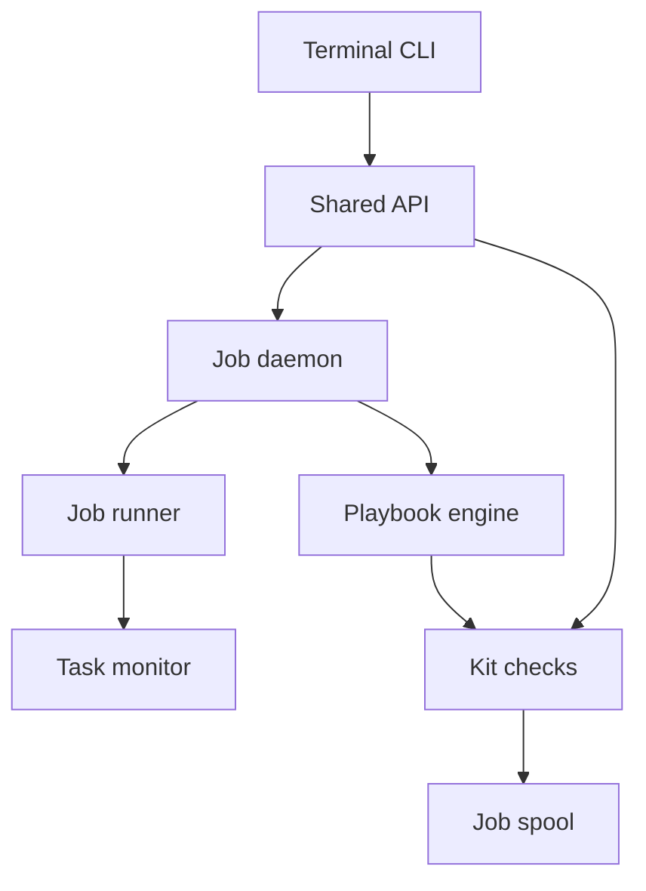

<h3>PR Summary by Qodo</h3>

Add terminal kickoff and kit apply, harden monitoring, and document operations

<code>✨ Enhancement</code> <code>🐞 Bug fix</code> <code>📝 Documentation</code> <code>🧪 Tests</code> <code>🕐 40+ Minutes</code>

AI Description

<dl>
<dd>
 

><pre>
>• Add terminal commands for the phone’s kickoff and kit-apply workflows when the phone is
>  unavailable.
>• Correct transcript discovery, killed-task reporting, and journal reminders; add playbook and
>  worktree warnings.
>• Record harness-probe limits and provide tested runbooks for stops, recovery, migration, and
>  installation.
></pre>

</dd>
</dl>

Diagram

<dl>
<dd>

 

</dd>
</dl>

High-Level Assessment

<dl>
<dd>

 

>The following are alternative approaches to this PR:

<b>1. Unify phone and terminal kit intake</b>

<dl>
<dd>

- ➕ One service could enforce identical validation, naming, placement, and held-job rules across both transports.
- ➖ Phone attachment fetching and collision renaming differ from terminal-supplied zip files; unification would broaden this PR and risk changing phone behavior.

</dd>
</dl>

>**Recommendation:** Keep the shared kickoff and held-apply filing paths introduced here. The transport-specific kit intake is reasonable for this scope; consider consolidating it only if future changes require identical intake policy across phone and terminal.

</dd>
</dl>

 Files changed (40) <code> +3998 / -246 </code> 

<dl>
<dd>

 

Enhancement (6) <code> +657 / -50 </code>

<dl>
<dd>

capture-quota-stop.sh<code>Add redacted usage-limit capture script</code> <code>+229/-0</code>

 

>Add redacted usage-limit capture script
>
><pre>
>• Collects CLI state, job records, logs, transcript excerpts, and inbox events even when the daemon is down. Writes one private output file after redacting known secret values and credential patterns.
></pre>
>
><a href='https://github.com/SigorMatt/hands/pull/5/files#diff-8aaeceeb41390e763bbf25d16de0f7662c3cd93c4286e286af0ece466fe82359'>scripts/capture-quota-stop.sh</a>

api.py<code>Share kickoff and add checked terminal kit apply</code> <code>+182/-46</code>

 

>Share kickoff and add checked terminal kit apply
>
><pre>
>• Exposes go through a common phone/CLI kickoff path and adds a daemon-side kit check, non-overwriting placement, and held apply. Moves journal-reminder responsibility out of enqueue and avoids repr-escaping typed job IDs in refusal text.
></pre>
>
><a href='https://github.com/SigorMatt/hands/pull/5/files#diff-16f021e493ba18b1e5f11a7ee4f78300324921ac8ae5a15bbe45cab098c59139'>src/hands/api.py</a>

cli.py<code>Expose go and kit apply commands</code> <code>+34/-3</code>

 

>Expose go and kit apply commands
>
><pre>
>• Adds command parsing, socket dispatch, and output rendering for a terminal kickoff and a zip-based kit apply.
></pre>
>
><a href='https://github.com/SigorMatt/hands/pull/5/files#diff-b53aaafe941dad7529e17dc5ad20b86fb13177f2778fbe0547c019ca0c4c8ce4'>src/hands/cli.py</a>

doctor.py<code>Warn about dangling role worktrees</code> <code>+63/-1</code>

 

>Warn about dangling role worktrees
>
><pre>
>• Adds a worktrees check that reads Git administration files, identifies missing linked-worktree paths, and names the prune remedy.
></pre>
>
><a href='https://github.com/SigorMatt/hands/pull/5/files#diff-3910c7af1fd466f413148b4c6d7df4a5256ce2fe25441aa2ebb485a058b52f18'>src/hands/doctor.py</a>

kit.py<code>Validate kit names and place zip files safely</code> <code>+125/-0</code>

 

>Validate kit names and place zip files safely
>
><pre>
>• Shares kit filename validation with the phone, adds non-overwriting placement and terminal apply handling, and includes non-failing orphaned-rule warnings in kit-check output.
></pre>
>
><a href='https://github.com/SigorMatt/hands/pull/5/files#diff-c741f63d4fccb12bbfc566ee658f6a10d5d610c9e09e4a336f11292aaa5c1b37'>src/hands/kit.py</a>

playbook.py<code>Warn when done rules lack orphaned rules</code> <code>+24/-0</code>

 

>Warn when done rules lack orphaned rules
>
><pre>
>• Adds one warning calculation for builder and aux rule pairs and logs its results when the engine loads a playbook.
></pre>
>
><a href='https://github.com/SigorMatt/hands/pull/5/files#diff-d4c45908377a317f0fbbccad6f8af7a74c4af564c4272d3cecc7126bf1be9204'>src/hands/playbook.py</a>

</dd>
</dl>

Bug fix (3) <code> +103 / -19 </code>

<dl>
<dd>

daemon.py<code>Decide reminders at dispatch and identify daemon stops</code> <code>+31/-1</code>

 

>Decide reminders at dispatch and identify daemon stops
>
><pre>
>• Computes a builder’s journal reminder when its job starts, excluding known kickoffs. Passes daemon-stop state to the monitor so shutdown-generated task notices are not reported as independent kills.
></pre>
>
><a href='https://github.com/SigorMatt/hands/pull/5/files#diff-2224a4a9fb4a4b1dff488eefd97ff2528609544c0e2c33da2ddf160312fb97d6'>src/hands/daemon.py</a>

monitor.py<code>Deduplicate killed tasks across session reads</code> <code>+31/-6</code>

 

>Deduplicate killed tasks across session reads
>
><pre>
>• Remembers reported transcript/task pairs across jobs and suppresses notices caused by the daemon’s own stop.
></pre>
>
><a href='https://github.com/SigorMatt/hands/pull/5/files#diff-41b58190f9c443cc770fa5bde2a4d3ba6d3440572fc62c25ef2ad05387debcce'>src/hands/monitor.py</a>

runner.py<code>Honor Claude config directory and dispatch preface</code> <code>+41/-12</code>

 

>Honor Claude config directory and dispatch preface
>
><pre>
>• Derives transcript paths from the job environment’s CLAUDE_CONFIG_DIR and records them when the session appears. Incorporates a dispatch-time journal preface into the running job’s recorded prompt.
></pre>
>
><a href='https://github.com/SigorMatt/hands/pull/5/files#diff-33639dfe2ec751f3319053b79320b1fb736bb2a8eac7a7082ae582f76782cf54'>src/hands/runner.py</a>

</dd>
</dl>

Refactor (1) <code> +21 / -76 </code>

<dl>
<dd>

phone.py<code>Route phone kickoff through shared API</code> <code>+21/-76</code>

 

>Route phone kickoff through shared API
>
><pre>
>• Replaces phone-local kickoff checks with Api.kickoff, shares kit filename validation, and corrects refusal documentation for malformed nonce commands.
></pre>
>
><a href='https://github.com/SigorMatt/hands/pull/5/files#diff-6d175ae5f33f6b544ecf5e01493181c805135928b88647bc51a3ff9971544b75'>src/hands/phone.py</a>

</dd>
</dl>

Tests (15) <code> +1665 / -14 </code>

<dl>
<dd>

conftest.py<code>Isolate transcript configuration in tests</code> <code>+3/-1</code>

 

>Isolate transcript configuration in tests
>
><pre>
>• Clears inherited CLAUDE_CONFIG_DIR so transcript-path tests remain hermetic.
></pre>
>
><a href='https://github.com/SigorMatt/hands/pull/5/files#diff-e52e4ddd58b7ef887ab03c04116e676f6280b824ab7469d5d3080e5cba4f2128'>tests/conftest.py</a>

fake_claude.py<code>Simulate transcripts and shutdown kills</code> <code>+45/-2</code>

 

>Simulate transcripts and shutdown kills
>
><pre>
>• Adds directives that write a Claude-shaped transcript and emit task-killed notices when the fake process receives a stop signal.
></pre>
>
><a href='https://github.com/SigorMatt/hands/pull/5/files#diff-576f2a01ee79a2436e7e9ca4d62d6857eff655720eba2b7cab791cdf9f2a2ea0'>tests/fake_claude.py</a>

fake_monitor.py<code>Verify monitor transcript access</code> <code>+20/-0</code>

 

>Verify monitor transcript access
>
><pre>
>• Adds an optional probe that reads the supplied transcript and emits its first line or an unreadable-path event.
></pre>
>
><a href='https://github.com/SigorMatt/hands/pull/5/files#diff-f17ad5f1d744d38cb9cc0d168c1e3bec369f6d848f53e25f31ca920f95a21209'>tests/fake_monitor.py</a>

test_docs.py<code>Pin operational documentation against behavior</code> <code>+194/-1</code>

 

>Pin operational documentation against behavior
>
><pre>
>• Checks new command and documentation claims against CLI, runner environment, guard, kit, and doctor behavior.
></pre>
>
><a href='https://github.com/SigorMatt/hands/pull/5/files#diff-5c6dddc0c85981eb75bdb49d400e82c9271918e138990baba53ac34cbcf2aaac'>tests/test_docs.py</a>

test_doctor.py<code>Exercise dangling-worktree diagnosis</code> <code>+70/-0</code>

 

>Exercise dangling-worktree diagnosis
>
><pre>
>• Tests missing and live linked worktrees, pruning recovery, relative gitdir paths, and unreadable administration entries.
></pre>
>
><a href='https://github.com/SigorMatt/hands/pull/5/files#diff-fade675e2c090faef5c26627755d9d4b80a5a3345b23b9573ff45493af4bb1ca'>tests/test_doctor.py</a>

test_gates.py<code>Adapt gate coverage to shared kickoff</code> <code>+5/-2</code>

 

>Adapt gate coverage to shared kickoff
>
><pre>
>• Keeps the existing phone-origin gate case on the low-level send path after removal of go_builder.
></pre>
>
><a href='https://github.com/SigorMatt/hands/pull/5/files#diff-792c3e3f9f4b3e7087f6ff3c8a585eaf2df8b8ef73f93cb7fca581f049b40d4e'>tests/test_gates.py</a>

test_hosted.py<code>Pin hosted-review verdict selection</code> <code>+94/-0</code>

 

>Pin hosted-review verdict selection
>
><pre>
>• Verifies that review bodies and inline comments cannot supply the Code Review verdict, the newest qualifying issue comment wins, and a fully struck one-finding result exits 4.
></pre>
>
><a href='https://github.com/SigorMatt/hands/pull/5/files#diff-944577b8becda0275093bef51ea669f15150974efca803e07510e73d1fe381ac'>tests/test_hosted.py</a>

test_kit.py<code>Test warnings and protocol instructions</code> <code>+242/-3</code>

 

>Test warnings and protocol instructions
>
><pre>
>• Covers non-failing orphaned-rule warnings and their JSON form, and pins refusal, worktree, commit-skip, and check-execution language in shipped templates.
></pre>
>
><a href='https://github.com/SigorMatt/hands/pull/5/files#diff-b3958ae2feb00d9e16b26db0a3af497629df71b4db8d583f8178a4c74fa901d3'>tests/test_kit.py</a>

test_monitor.py<code>Test killed-task and transcript fixes</code> <code>+125/-2</code>

 

>Test killed-task and transcript fixes
>
><pre>
>• Exercises deduplication across repeated session reads, contrasts daemon stop with human cancel, and confirms the monitor reads a transcript under CLAUDE_CONFIG_DIR.
></pre>
>
><a href='https://github.com/SigorMatt/hands/pull/5/files#diff-4fa9465e1c06c9eca53b9ca51b7e391d33999d84eddf21ea205d19e7c3c1a872'>tests/test_monitor.py</a>

test_operations.py<code>Exercise terminal kickoff and kit apply end to end</code> <code>+230/-0</code>

 

>Exercise terminal kickoff and kit apply end to end
>
><pre>
>• Tests CLI-to-daemon kickoff behavior and kit checks, placement, held-job filing, approval, same-byte reuse, and collision refusal using a fake harness.
></pre>
>
><a href='https://github.com/SigorMatt/hands/pull/5/files#diff-1aa04b3ddd9ae5c8201617165caa391614aa6857fe6bda08ebe2b071b5ab28f8'>tests/test_operations.py</a>

test_phone.py<code>Cover dispatch timing and secret-safe refusals</code> <code>+92/-2</code>

 

>Cover dispatch timing and secret-safe refusals
>
><pre>
>• Adapts kickoff tests to the shared API, checks that held prompts gain journal reminders only when dispatched, and guards against backslash-secret leakage in job-ID refusals.
></pre>
>
><a href='https://github.com/SigorMatt/hands/pull/5/files#diff-1ab2e74caabf626cc62c44917bc5256134d853d258c94ca530d29bc4486e89b3'>tests/test_phone.py</a>

test_playbook.py<code>Test engine orphaned-rule warnings</code> <code>+64/-0</code>

 

>Test engine orphaned-rule warnings
>
><pre>
>• Verifies warnings for each missing orphaned pairing and no warning when both pairings exist or no relevant done rule exists.
></pre>
>
><a href='https://github.com/SigorMatt/hands/pull/5/files#diff-00966bca5744c3edcaf16252d9a9e5dbe092f5f76422c5357077b91f27f001dc'>tests/test_playbook.py</a>

test_project_add.py<code>Pin existing clone failure guarantees</code> <code>+39/-1</code>

 

>Pin existing clone failure guarantees
>
><pre>
>• Adds regressions for the dry-run clone separator and cleanup when setting a clone’s push URL fails.
></pre>
>
><a href='https://github.com/SigorMatt/hands/pull/5/files#diff-436f3fb29718e33bed1cfb13f85f213b3cef9d5b27c34cfa39497277a8efbbec'>tests/test_project_add.py</a>

test_runbook.py<code>Validate runbook and capture redaction</code> <code>+406/-0</code>

 

>Validate runbook and capture redaction
>
><pre>
>• Checks operational inventory, command mappings, and absence of credential-shaped text. Runs the capture script against planted secrets and fake commands, including a daemon-down case.
></pre>
>
><a href='https://github.com/SigorMatt/hands/pull/5/files#diff-314fe6bb3c8e0eee6265ccbeed8fbea981813c83d2327e38557ba9159da8b9f2'>tests/test_runbook.py</a>

test_runner.py<code>Verify configured transcript paths</code> <code>+36/-0</code>

 

>Verify configured transcript paths
>
><pre>
>• Checks absolute, relative, and default Claude configuration directories and confirms the recorded path matches the fake harness’s transcript.
></pre>
>
><a href='https://github.com/SigorMatt/hands/pull/5/files#diff-55824c57bc66ac238570c2acc0d4904ab52df3131aae66c0ecefc2f08a4e8806'>tests/test_runner.py</a>

</dd>
</dl>

Documentation (15) <code> +1552 / -87 </code>

<dl>
<dd>

README.md<code>Surface terminal operations and new guides</code> <code>+14/-2</code>

 

>Surface terminal operations and new guides
>
><pre>
>• Lists go and kit apply alongside existing commands and explains their held-job behavior. Points readers to the operations runbook and harness probe.
></pre>
>
><a href='https://github.com/SigorMatt/hands/pull/5/files#diff-b335630551682c19a781afebcf4d07bf978fb1f8ac04c6bf87428ed5106870f5'>README.md</a>

CLAUDE.md<code>Define escalation for unauthorable units</code> <code>+9/-3</code>

 

>Define escalation for unauthorable units
>
><pre>
>• Extends architect rule 8 to request human-supplied content when a sub-agent refuses a unit, without having the architect author that content.
></pre>
>
><a href='https://github.com/SigorMatt/hands/pull/5/files#diff-c7481d712d315e34b3da6aac27aaebe24ec06bb80ebb35f3c1c5e073b561920e'>architect/CLAUDE.md</a>

ARCHITECT-HANDBOOK.md<code>Explain review hygiene and new operational paths</code> <code>+41/-0</code>

 

>Explain review hygiene and new operational paths
>
><pre>
>• Documents refusal escalation, worktree cleanup, review exclusions, orphaned-rule warnings, and terminal operations.
></pre>
>
><a href='https://github.com/SigorMatt/hands/pull/5/files#diff-2ad26343d21a57c4b0e1450bc61bad64fd9ee975037b345cdcf9841cdab2905e'>docs/ARCHITECT-HANDBOOK.md</a>

HARNESS-PROBE.md<code>Record dated Codex, OpenCode, and dsh probe</code> <code>+495/-0</code>

 

>Record dated Codex, OpenCode, and dsh probe
>
><pre>
>• Records observed commands, outputs, permissions, sessions, and requirement gaps. Distinguishes live Codex results from OpenCode and dsh capabilities that could not be exercised.
></pre>
>
><a href='https://github.com/SigorMatt/hands/pull/5/files#diff-9a76afd1826d001d56d8569942594df3b5800d64892c5f898d6bf222db22c8ec'>docs/HARNESS-PROBE.md</a>

INTEGRATION.md<code>Document terminal workflows and environment constraints</code> <code>+73/-5</code>

 

>Document terminal workflows and environment constraints
>
><pre>
>• Explains go and kit apply, nvm PATH configuration, CLAUDE_CONFIG_DIR transcripts, doctor’s worktree warning, and kit-check warnings. Corrects the description of malformed phone decisions.
></pre>
>
><a href='https://github.com/SigorMatt/hands/pull/5/files#diff-9610d0a1913600337b4a1fb10a0a3ca941655e61137a7e2ee493dfec6c622d99'>docs/INTEGRATION.md</a>

OPERATIONS.md<code>Add human operations and recovery runbook</code> <code>+420/-0</code>

 

>Add human operations and recovery runbook
>
><pre>
>• Inventories machine state and secrets, then provides procedures for usage-limit stops, operating without a phone, migration, disaster recovery, and release installation.
></pre>
>
><a href='https://github.com/SigorMatt/hands/pull/5/files#diff-3b441db82a6aa05a4005032fb6541cc4719b4ef8308cb78ddcfcb80a6da0bf91'>docs/OPERATIONS.md</a>

PLAYBOOK.md<code>Explain missing orphaned-rule warnings</code> <code>+10/-0</code>

 

>Explain missing orphaned-rule warnings
>
><pre>
>• Clarifies that a done rule without its corresponding orphaned rule warns without blocking kit checks or playbook loading.
></pre>
>
><a href='https://github.com/SigorMatt/hands/pull/5/files#diff-2caab8322fd895d19c2c0aeb1e9d4d48abe9a134afd0ade65bdb75b661a8eff0'>docs/PLAYBOOK.md</a>

CHECKPOINT.md<code>Advance checkpoint to mission 24</code> <code>+21/-20</code>

 

>Advance checkpoint to mission 24
>
><pre>
>• Replaces mission 23 progress with completed mission 24 units, their verification notes, and remaining report work.
></pre>
>
><a href='https://github.com/SigorMatt/hands/pull/5/files#diff-ea6fe37f51c315b66c5f700d302e82876099d5e56dca9614d58d4db344903b78'>meta/CHECKPOINT.md</a>

FINAL-REPORT-24.md<code>Record mission 24 results and limits</code> <code>+234/-0</code>

 

>Record mission 24 results and limits
>
><pre>
>• Summarizes unit commits, test coverage, unproven behavior, prior-review dispositions, and findings. Notes that hosted review remains pending in the committed report.
></pre>
>
><a href='https://github.com/SigorMatt/hands/pull/5/files#diff-59a68e439194caf0a24c6f0d35eaca88f64140a671bbfd075e2be0f00ea954af'>meta/FINAL-REPORT-24.md</a>

REVIEW-PROTOCOL.md<code>Tighten review cleanup and gate rules</code> <code>+24/-5</code>

 

>Tighten review cleanup and gate rules
>
><pre>
>• Requires pruning stale worktrees and removing review-created ones, specifies which commits receive unit review, and requires one completed foreground check per sub-agent.
></pre>
>
><a href='https://github.com/SigorMatt/hands/pull/5/files#diff-d136b4ee2cca075a1117349d23c7a4be93a3bd39bc5aaad31471473f17afa8cf'>meta/REVIEW-PROTOCOL.md</a>

FINDINGS.md<code>Resolve and track mission 24 findings</code> <code>+129/-2</code>

 

>Resolve and track mission 24 findings
>
><pre>
>• Records H-062 through H-069 and their dispositions, resolves H-061 through the new warning behavior, and corrects H-051’s description of architect read roots.
></pre>
>
><a href='https://github.com/SigorMatt/hands/pull/5/files#diff-15d0d274f2f7c3edd933310939b6c0581b53648f48d23f2039cca510e9aa21cd'>meta/findings/FINDINGS.md</a>

journal.md<code>Append mission 24 unit record</code> <code>+11/-0</code>

 

>Append mission 24 unit record
>
><pre>
>• Records each unit’s outcome, test results, known gaps, and the final-report handoff.
></pre>
>
><a href='https://github.com/SigorMatt/hands/pull/5/files#diff-9f0a1b37813ca47db6195fa5c6e69a32efcef6da121060bbd5f1d558be1cbeda'>meta/journal.md</a>

plan.md<code>Replace mission plan and findings map</code> <code>+41/-42</code>

 

>Replace mission plan and findings map
>
><pre>
>• Tracks mission 24 units, dependencies, prior-review items, and findings, including the new refused-unit state.
></pre>
>
><a href='https://github.com/SigorMatt/hands/pull/5/files#diff-7b1c6ea9ab4fd6179a8304348a94fbf1fa61cfb6aafed7ec549bcd7b7f8df461'>meta/plan.md</a>

BUILDER-N-PROMPT.md<code>Specify refused-unit handling</code> <code>+6/-3</code>

 

>Specify refused-unit handling
>
><pre>
>• Tells sub-agents to stop without changes when they cannot author a unit and tells orchestrators to mark that unit refused without retrying it.
></pre>
>
><a href='https://github.com/SigorMatt/hands/pull/5/files#diff-4abca313f3571f857a4d82f471a44d49fcb38a568dba8775b9e3aa7e82e30dca'>templates/BUILDER-N-PROMPT.md</a>

REVIEW-PROTOCOL.md<code>Carry updated review hygiene into template</code> <code>+24/-5</code>

 

>Carry updated review hygiene into template
>
><pre>
>• Adds worktree cleanup, explicit bookkeeping-commit exclusions, and the foreground single-check rule to generated review instructions.
></pre>
>
><a href='https://github.com/SigorMatt/hands/pull/5/files#diff-1a13ad1e2168d9dd38e2e3f07712fc77e6d7bbef5b55f45f54dbd1737103bfb6'>templates/REVIEW-PROTOCOL.md</a>

</dd>
</dl>

</dd>
</dl>

