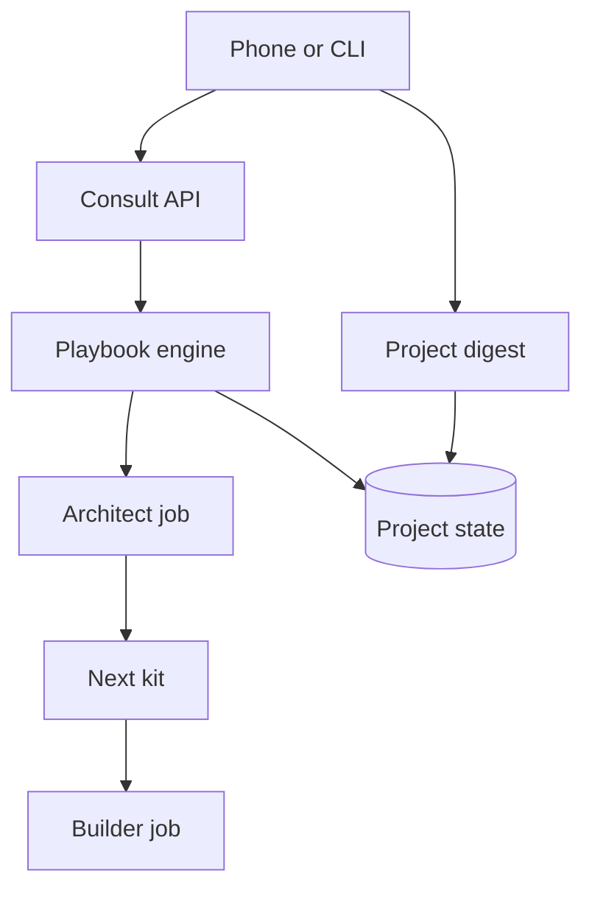

<h3>PR Summary by Qodo</h3>

Add human-started consultations, project digests, and decisions kits

<code>✨ Enhancement</code> <code>📝 Documentation</code> <code>🧪 Tests</code> <code>🕐 40+ Minutes</code>

AI Description

<dl>
<dd>
 

><pre>
>• Let humans start architect consultations from the phone or CLI without reciting a review.
></pre>

</dd>
</dl>

Diagram

<dl>
<dd>

 

</dd>
</dl>

High-Level Assessment

<dl>
<dd>

 

>The following are alternative approaches to this PR:

<b>1. Represent human consultations as synthetic review events</b>

<dl>
<dd>

- ➕ Could reuse more of the existing event-driven consultation path.
- ➖ Would manufacture a job and review context that do not exist, obscuring origin, prompt content, and audit fields.

</dd>
</dl>

<b>2. Aggregate digests through running daemons</b>

<dl>
<dd>

- ➕ Could reuse daemon status responses for live information.
- ➖ Would fail to report projects whose daemons are down and make the laptop command depend on daemon availability.

</dd>
</dl>

>**Recommendation:** Keep the shared API entry point and explicit no-event-job engine path: they preserve consultation accounting without pretending the human supplied a review. The read-only client-side digest is appropriate because reporting down daemons is part of its purpose. Review attachment refusal and cleanup behavior carefully at the phone boundary.

</dd>
</dl>

 Files changed (27) <code> +3550 / -188 </code> 

<dl>
<dd>

 

Enhancement (6) <code> +933 / -57 </code>

<dl>
<dd>

api.py<code>Centralize consultation checks and restrict owner-kit filing</code> <code>+135/-4</code>

 

>Centralize consultation checks and restrict owner-kit filing
>
><pre>
>• Adds shared reason and attachment validation plus an API path for phone and CLI consultations, including role, busy-job, wait, and budget refusals. Refuses architect-filed decisions kits so owner files remain human-supplied.
></pre>
>
><a href='https://github.com/SigorMatt/hands/pull/6/files#diff-16f021e493ba18b1e5f11a7ee4f78300324921ac8ae5a15bbe45cab098c59139'>src/hands/api.py</a>

cli.py<code>Expose hands consult and hands digest</code> <code>+76/-2</code>

 

>Expose hands consult and hands digest
>
><pre>
>• Adds a socket-backed consultation command with an optional checked UTF-8 Markdown file. Adds a daemon-independent digest command with JSON output.
></pre>
>
><a href='https://github.com/SigorMatt/hands/pull/6/files#diff-b53aaafe941dad7529e17dc5ad20b86fb13177f2778fbe0547c019ca0c4c8ce4'>src/hands/cli.py</a>

digest.py<code>Build read-only, redacted cross-project digests</code> <code>+257/-0</code>

 

>Build read-only, redacted cross-project digests
>
><pre>
>• Reads each project configuration, spool, playbook, and checkpoint to produce a status line, probing daemon sockets with a two-second limit. Redacts all loadable projects&#x27; command secrets and notification tokens before truncating fields.
></pre>
>
><a href='https://github.com/SigorMatt/hands/pull/6/files#diff-d6edbc411264d72597d0cd3fe26aeb0e20e1a11898537ac47e855be90cf21838'>src/hands/digest.py</a>

kit.py<code>Recognize owner-only decisions kits</code> <code>+100/-9</code>

 

>Recognize owner-only decisions kits
>
><pre>
>• Allows kits containing only owner files and a qualifying KIT.md to pass all six checks without a brief or replacement playbook. Exposes decisions-kit status in reports and shares basename validation with consultation attachments.
></pre>
>
><a href='https://github.com/SigorMatt/hands/pull/6/files#diff-c741f63d4fccb12bbfc566ee658f6a10d5d610c9e09e4a336f11292aaa5c1b37'>src/hands/kit.py</a>

phone.py<code>Accept phone consult and digest commands</code> <code>+174/-30</code>

 

>Accept phone consult and digest commands
>
><pre>
>• Routes authenticated consultation requests through the shared API, fetching optional capped Markdown attachments and publishing refusals. Publishes the same redacted digest as the CLI and preserves attachment extensions when resolving filename collisions.
></pre>
>
><a href='https://github.com/SigorMatt/hands/pull/6/files#diff-6d175ae5f33f6b544ecf5e01493181c805135928b88647bc51a3ff9971544b75'>src/hands/phone.py</a>

playbook.py<code>Start and account for human-requested architect consultations</code> <code>+191/-12</code>

 

>Start and account for human-requested architect consultations
>
><pre>
>• Adds a consultation path without an event job, replacing review content with the human&#x27;s reason while retaining the architect brief and verdict workflow. Records request origin and reason hash, enforces the prompt and consultation budgets, and identifies human consultations in completion records.
></pre>
>
><a href='https://github.com/SigorMatt/hands/pull/6/files#diff-d4c45908377a317f0fbbccad6f8af7a74c4af564c4272d3cecc7126bf1be9204'>src/hands/playbook.py</a>

</dd>
</dl>

Tests (9) <code> +1979 / -10 </code>

<dl>
<dd>

test_bash_guard.py<code>Pin guard restrictions on cross-role commands</code> <code>+48/-0</code>

 

>Pin guard restrictions on cross-role commands
>
><pre>
>• Checks that guarded roles reject consult and digest, including during a human-started architect consultation, while preserving the architect&#x27;s permitted read commands.
></pre>
>
><a href='https://github.com/SigorMatt/hands/pull/6/files#diff-4bed1c89964adf4a3a3fe55e295ac969a3393da5d499782e5a1c9af10e8992e8'>tests/test_bash_guard.py</a>

test_consult.py<code>Exercise CLI consultation lifecycle</code> <code>+572/-0</code>

 

>Exercise CLI consultation lifecycle
>
><pre>
>• Tests prompts, event fields, budgets, busy-role refusals, file validation, pause recovery, and next-kit application through the daemon and CLI. Pins existing review consultation prompts and event fields against regressions.
></pre>
>
><a href='https://github.com/SigorMatt/hands/pull/6/files#diff-7131a9d0f5d0c3b813bf1bc7a3386bd4956b37878d1fab73bf9d531768d9d2ea'>tests/test_consult.py</a>

test_digest.py<code>Verify digest output, redaction, and read-only behavior</code> <code>+302/-0</code>

 

>Verify digest output, redaction, and read-only behavior
>
><pre>
>• Covers multi-project ordering and fields, unavailable sockets, broken configs, JSON output, secret redaction before truncation, and absence of filesystem writes.
></pre>
>
><a href='https://github.com/SigorMatt/hands/pull/6/files#diff-e979db48433aa220d5576e452cc7aaf47fc11db352dff88cf9e8cc8983511369'>tests/test_digest.py</a>

test_docs.py<code>Check command documentation stays synchronized</code> <code>+61/-9</code>

 

>Check command documentation stays synchronized
>
><pre>
>• Updates phone-command counts and verifies consult and digest descriptions across the README, integration guide, phone module, and CLI help.
></pre>
>
><a href='https://github.com/SigorMatt/hands/pull/6/files#diff-5c6dddc0c85981eb75bdb49d400e82c9271918e138990baba53ac34cbcf2aaac'>tests/test_docs.py</a>

test_handbook.py<code>Pin consultation handbook guidance</code> <code>+11/-1</code>

 

>Pin consultation handbook guidance
>
><pre>
>• Checks that the handbook describes human consultations and no longer offers the aux review-recital workaround.
></pre>
>
><a href='https://github.com/SigorMatt/hands/pull/6/files#diff-7b18bfb854d4bd695c05bcd4fea94ac6aab1829e82e0b5b13a533767c458f546'>tests/test_handbook.py</a>

test_kit.py<code>Cover decisions-kit recognition and filing restrictions</code> <code>+208/-0</code>

 

>Cover decisions-kit recognition and filing restrictions
>
><pre>
>• Tests valid owner-only kits in zip and directory forms, invalid variants, six-check reports, and the builder recovery instruction. Verifies architect kit filing refuses a decisions kit without retaining it.
></pre>
>
><a href='https://github.com/SigorMatt/hands/pull/6/files#diff-b3958ae2feb00d9e16b26db0a3af497629df71b4db8d583f8178a4c74fa901d3'>tests/test_kit.py</a>

test_operations.py<code>Test laptop application of a decisions kit</code> <code>+34/-0</code>

 

>Test laptop application of a decisions kit
>
><pre>
>• Confirms a passing decisions kit produces a held builder apply with the expected plan-only prompt and owner commit message.
></pre>
>
><a href='https://github.com/SigorMatt/hands/pull/6/files#diff-1aa04b3ddd9ae5c8201617165caa391614aa6857fe6bda08ebe2b071b5ab28f8'>tests/test_operations.py</a>

test_operator_table.py<code>Validate operator routes and project instructions</code> <code>+425/-0</code>

 

>Validate operator routes and project instructions
>
><pre>
>• Checks table structure and coverage of shipped playbook notifications, decision and digest routes, HF report guidance, and onboarding text. Pins the project instruction and verifies it appears in project-add output.
></pre>
>
><a href='https://github.com/SigorMatt/hands/pull/6/files#diff-9cb3db68dbfe38e0f721592b1254b54bbead87e66798bf88ee11c1c23175e922'>tests/test_operator_table.py</a>

test_phone.py<code>Exercise phone digest, consult, and decisions-kit delivery</code> <code>+318/-0</code>

 

>Exercise phone digest, consult, and decisions-kit delivery
>
><pre>
>• Tests published digests and consultation responses, attachment handling and refusals, secret checks, and human-started consultation events. Confirms phone-delivered decisions kits create held apply jobs.
></pre>
>
><a href='https://github.com/SigorMatt/hands/pull/6/files#diff-1ab2e74caabf626cc62c44917bc5256134d853d258c94ca530d29bc4486e89b3'>tests/test_phone.py</a>

</dd>
</dl>

Documentation (12) <code> +638 / -121 </code>

<dl>
<dd>

README.md<code>Introduce consultation and digest commands</code> <code>+20/-4</code>

 

>Introduce consultation and digest commands
>
><pre>
>• Lists both new phone commands and their laptop forms, including consultation limits and digest redaction. Points operators to the handbook&#x27;s notification table.
></pre>
>
><a href='https://github.com/SigorMatt/hands/pull/6/files#diff-b335630551682c19a781afebcf4d07bf978fb1f8ac04c6bf87428ed5106870f5'>README.md</a>

CLAUDE.md<code>Guide architect responses to human consultations</code> <code>+10/-3</code>

 

>Guide architect responses to human consultations
>
><pre>
>• Replaces the old owner-file handoff with the decisions-kit route and instructs the architect role to handle a human-started consultation like other consultation outcomes.
></pre>
>
><a href='https://github.com/SigorMatt/hands/pull/6/files#diff-c7481d712d315e34b3da6aac27aaebe24ec06bb80ebb35f3c1c5e073b561920e'>architect/CLAUDE.md</a>

ARCHITECT-HANDBOOK.md<code>Document project ownership and notification routes</code> <code>+303/-48</code>

 

>Document project ownership and notification routes
>
><pre>
>• Adds decisions-kit and consultation guidance, retires the review-recital workaround, and defines a four-column operator table. Describes project-chat responsibilities, onboarding, and evidence-only HF reports.
></pre>
>
><a href='https://github.com/SigorMatt/hands/pull/6/files#diff-2ad26343d21a57c4b0e1450bc61bad64fd9ee975037b345cdcf9841cdab2905e'>docs/ARCHITECT-HANDBOOK.md</a>

ARCHITECT-INSTRUCTION.md<code>Assign project operations to the project&#x27;s chat</code> <code>+33/-12</code>

 

>Assign project operations to the project&#x27;s chat
>
><pre>
>• Directs the project architect chat to answer notifications using the handbook&#x27;s operator table and to provide complete phone commands or aux prompts. Specifies decisions-kit delivery and separates project operations from machine-wide hands operations.
></pre>
>
><a href='https://github.com/SigorMatt/hands/pull/6/files#diff-c13b869d7818ef55c4093e329c68d7350090d26ba16b892bacf1d783ae842472'>docs/ARCHITECT-INSTRUCTION.md</a>

INTEGRATION.md<code>Document command-channel additions and gate timeouts</code> <code>+52/-3</code>

 

>Document command-channel additions and gate timeouts
>
><pre>
>• Explains phone consult and digest behavior, including attachments, refusals, and reported fields. Documents how projects with long gates can raise role timeout settings.
></pre>
>
><a href='https://github.com/SigorMatt/hands/pull/6/files#diff-9610d0a1913600337b4a1fb10a0a3ca941655e61137a7e2ee493dfec6c622d99'>docs/INTEGRATION.md</a>

OPERATIONS.md<code>Add no-phone equivalents for consult and digest</code> <code>+2/-0</code>

 

>Add no-phone equivalents for consult and digest
>
><pre>
>• Adds both commands to the phone-to-laptop operations table.
></pre>
>
><a href='https://github.com/SigorMatt/hands/pull/6/files#diff-3b441db82a6aa05a4005032fb6541cc4719b4ef8308cb78ddcfcb80a6da0bf91'>docs/OPERATIONS.md</a>

CHECKPOINT.md<code>Track mission 26 execution and remaining work</code> <code>+18/-21</code>

 

>Track mission 26 execution and remaining work
>
><pre>
>• Replaces the mission 25 checkpoint with completed mission 26 units, gate results, known unproven cases, and the pending hosted-review step.
></pre>
>
><a href='https://github.com/SigorMatt/hands/pull/6/files#diff-ea6fe37f51c315b66c5f700d302e82876099d5e56dca9614d58d4db344903b78'>meta/CHECKPOINT.md</a>

FINAL-REPORT-26.md<code>Record mission 26 results and limits of verification</code> <code>+104/-0</code>

 

>Record mission 26 results and limits of verification
>
><pre>
>• Summarizes implementation units, test evidence, deviations, deferred review items, and behavior not yet proven in real phone or builder operation.
></pre>
>
><a href='https://github.com/SigorMatt/hands/pull/6/files#diff-9bbaefcde490a7fd17adfd8b52fb207d151144ea25e067275a01d84dcf4dc803'>meta/FINAL-REPORT-26.md</a>

FINDINGS.md<code>Record three cross-project findings</code> <code>+51/-0</code>

 

>Record three cross-project findings
>
><pre>
>• Files H-070 and H-071 for later work and records H-072&#x27;s timeout guidance as resolved by documentation.
></pre>
>
><a href='https://github.com/SigorMatt/hands/pull/6/files#diff-15d0d274f2f7c3edd933310939b6c0581b53648f48d23f2039cca510e9aa21cd'>meta/findings/FINDINGS.md</a>

journal.md<code>Append mission 26 unit outcomes</code> <code>+6/-0</code>

 

>Append mission 26 unit outcomes
>
><pre>
>• Records each unit&#x27;s scope, gate results, and outstanding verification gaps.
></pre>
>
><a href='https://github.com/SigorMatt/hands/pull/6/files#diff-9f0a1b37813ca47db6195fa5c6e69a32efcef6da121060bbd5f1d558be1cbeda'>meta/journal.md</a>

plan.md<code>Replace mission plan with project-separation units</code> <code>+35/-29</code>

 

>Replace mission plan with project-separation units
>
><pre>
>• Tracks the consult, digest, decisions-kit, documentation, and final-report units and explicitly defers work outside mission 26.
></pre>
>
><a href='https://github.com/SigorMatt/hands/pull/6/files#diff-7b1c6ea9ab4fd6179a8304348a94fbf1fa61cfb6aafed7ec549bcd7b7f8df461'>meta/plan.md</a>

BUILDER-N-PROMPT.md<code>Carry owner decisions into resumed missions</code> <code>+4/-1</code>

 

>Carry owner decisions into resumed missions
>
><pre>
>• Instructs a resumed builder to perform and record unfinished steps from a newly committed owner file before continuing.
></pre>
>
><a href='https://github.com/SigorMatt/hands/pull/6/files#diff-4abca313f3571f857a4d82f471a44d49fcb38a568dba8775b9e3aa7e82e30dca'>templates/BUILDER-N-PROMPT.md</a>

</dd>
</dl>

</dd>
</dl>

