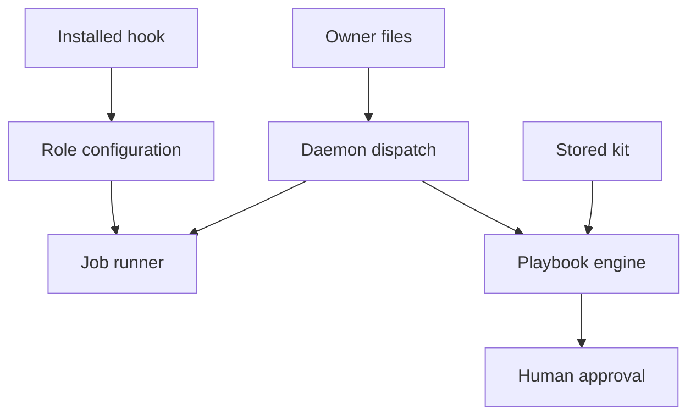

<h3>PR Summary by Qodo</h3>

Safeguard autonomous playbook changes and builder job dispatch

<code>🐞 Bug fix</code> <code>✨ Enhancement</code> <code>🧪 Tests</code> <code>📝 Documentation</code> <code>⚙️ Configuration changes</code> <code>🕐 40+ Minutes</code>

AI Description

<dl>
<dd>
 

><pre>
>• Hold architect-filed playbook changes for human approval, even in autonomous series.
>• Remind builders about pending owner decisions and safely disable background tasks where supported.
>• Align review guidance, operator documentation, and regression tests with these safeguards.
></pre>

</dd>
</dl>

Diagram

<dl>
<dd>

 

</dd>
</dl>

High-Level Assessment

<dl>
<dd>

 

>The following are alternative approaches to this PR:

<b>1. Persist pending owner decisions</b>

<dl>
<dd>

- ➕ Avoid repeated Git-history queries at builder dispatch.
- ➖ Adds state to reconcile after merges, restarts, and externally made commits.

</dd>
</dl>

<b>2. Trust kit metadata for playbook presence</b>

<dl>
<dd>

- ➕ Avoid reading the stored zip during autonomous approval.
- ➖ Metadata could diverge from the bytes being approved, weakening the ownership boundary.

</dd>
</dl>

>**Recommendation:** Keep the PR’s Git-derived owner reminder and verified-zip approval check: both derive decisions from the current authoritative artifacts rather than introducing state that can become stale. Review the dispatch-time Git cost and the documented exception for a kit filed while the pipeline is already paused.

</dd>
</dl>

 Files changed (41) <code> +3415 / -259 </code> 

<dl>
<dd>

 

Enhancement (6) <code> +273 / -15 </code>

<dl>
<dd>

bash_guard.py<code>Admit four read-only inspection options</code> <code>+37/-6</code>

 

>Admit four read-only inspection options
>
><pre>
>• Allows &#x27;ls -R&#x27;, &#x27;git ls-tree --name-only&#x27;, &#x27;git status --short&#x27;, and &#x27;git log --date=&lt;format&gt;&#x27;. Keeps neighboring options and a valueless &#x27;--date&#x27; refused, with self-test cases for both guarded roles.
></pre>
>
><a href='https://github.com/SigorMatt/hands/pull/7/files#diff-19f2ab92dd12e6110ca94a59853d99703e4636cababa636d2003000b7b53a974'>driver/hooks/bash_guard.py</a>

config.py<code>Centralize background-task environment decisions</code> <code>+116/-0</code>

 

>Centralize background-task environment decisions
>
><pre>
>• Compares role hooks with the installed copy and calculates the effective disable variable, its source, and diagnostic warnings. Role environment entries override defaults; builder and aux receive the default only with a matching hook.
></pre>
>
><a href='https://github.com/SigorMatt/hands/pull/7/files#diff-bee58eb7fec766fa3b7a3615f745a974c94fd209b85d819fc80e50315ea5dd93'>src/hands/config.py</a>

daemon.py<code>Add dispatch-time owner reminders and hold reasons</code> <code>+45/-4</code>

 

>Add dispatch-time owner reminders and hold reasons
>
><pre>
>• Builds builder prefaces from journal and pending-owner sentences in that order, excluding applies and their resumes. Lets playbook holds publish an owner-specific reason without changing the job’s gate reason.
></pre>
>
><a href='https://github.com/SigorMatt/hands/pull/7/files#diff-2224a4a9fb4a4b1dff488eefd97ff2528609544c0e2c33da2ddf160312fb97d6'>src/hands/daemon.py</a>

doctor.py<code>Report effective background-task settings per role</code> <code>+20/-1</code>

 

>Report effective background-task settings per role
>
><pre>
>• Uses the runner’s shared configuration decision to display the variable and hook comparison. Warns rather than fails when a builder or aux hook is missing or differs.
></pre>
>
><a href='https://github.com/SigorMatt/hands/pull/7/files#diff-3910c7af1fd466f413148b4c6d7df4a5256ce2fe25441aa2ebb485a058b52f18'>src/hands/doctor.py</a>

kit.py<code>Warn when a checked kit carries an autonomous playbook</code> <code>+38/-4</code>

 

>Warn when a checked kit carries an autonomous playbook
>
><pre>
>• Adds a non-failing &#x27;WARN playbook:&#x27; when a playbook-bearing kit meets autonomous role-mode conditions in the repository or kit. Shares the recognized playbook paths with stored-kit inspection.
></pre>
>
><a href='https://github.com/SigorMatt/hands/pull/7/files#diff-c741f63d4fccb12bbfc566ee658f6a10d5d610c9e09e4a336f11292aaa5c1b37'>src/hands/kit.py</a>

spool.py<code>Inspect stored kit zips for playbook paths</code> <code>+17/-0</code>

 

>Inspect stored kit zips for playbook paths
>
><pre>
>• Defines the shared playbook paths and reads stored zip entry names for the approval check. Returns an indeterminate result if the zip cannot be read.
></pre>
>
><a href='https://github.com/SigorMatt/hands/pull/7/files#diff-afef6fe420dcdc67164710839c508470d94b5a42c23284c4d8cbca7fe9a71221'>src/hands/spool.py</a>

</dd>
</dl>

Bug fix (5) <code> +293 / -45 </code>

<dl>
<dd>

no_background.py<code>Permit foreground sub-agents when background tasks are disabled</code> <code>+72/-22</code>

 

>Permit foreground sub-agents when background tasks are disabled
>
><pre>
>• Admits omitted or null sub-agent background flags only when Claude Code’s disable variable is set to a recognized value. Retains refusal of explicit background requests and replaces the obsolete 20-minute Bash advice.
></pre>
>
><a href='https://github.com/SigorMatt/hands/pull/7/files#diff-0904da66309e7d58421010c1e38e55c7b997c7833ca1165e108e95af5a3545b3'>.claude/hooks/no_background.py</a>

api.py<code>Show the sender’s prompt in job summaries</code> <code>+13/-4</code>

 

>Show the sender’s prompt in job summaries
>
><pre>
>• Removes hands-added leading reminders from &#x27;prompt_line&#x27;. Stored-prompt grep behavior remains unchanged.
></pre>
>
><a href='https://github.com/SigorMatt/hands/pull/7/files#diff-16f021e493ba18b1e5f11a7ee4f78300324921ac8ae5a15bbe45cab098c59139'>src/hands/api.py</a>

limits.py<code>Keep dispatch reminders out of limit resumes</code> <code>+8/-2</code>

 

>Keep dispatch reminders out of limit resumes
>
><pre>
>• Resends the sender’s original prompt rather than replaying hands-added journal or owner sentences; dispatch can then decide fresh reminders.
></pre>
>
><a href='https://github.com/SigorMatt/hands/pull/7/files#diff-f56818881f6e7b40991be9c9d33fdf5544c80847fd32e06d4f8c6b4cb25fe7e2'>src/hands/limits.py</a>

playbook.py<code>Protect autonomous applies and track pending owner files</code> <code>+183/-14</code>

 

>Protect autonomous applies and track pending owner files
>
><pre>
>• Finds committed owner decisions without a later checkpoint update and strips dispatch reminders where stored prompts are interpreted. Refuses automatic approval of a verified kit carrying either playbook path, publishing a human-actionable hold instead.
></pre>
>
><a href='https://github.com/SigorMatt/hands/pull/7/files#diff-d4c45908377a317f0fbbccad6f8af7a74c4af564c4272d3cecc7126bf1be9204'>src/hands/playbook.py</a>

runner.py<code>Apply the safe background-task setting at dispatch</code> <code>+17/-3</code>

 

>Apply the safe background-task setting at dispatch
>
><pre>
>• Drops the daemon’s inherited disable variable and installs only the value determined for the role. Clarifies that the prompt cap counts dispatch prefaces.
></pre>
>
><a href='https://github.com/SigorMatt/hands/pull/7/files#diff-33639dfe2ec751f3319053b79320b1fb736bb2a8eac7a7082ae582f76782cf54'>src/hands/runner.py</a>

</dd>
</dl>

Tests (14) <code> +2172 / -74 </code>

<dl>
<dd>

playbook_example.toml<code>Align the example fixture with DESIGN</code> <code>+2/-1</code>

 

>Align the example fixture with DESIGN
>
><pre>
>• Makes the killed-task rule notify with its prescribed message instead of stopping.
></pre>
>
><a href='https://github.com/SigorMatt/hands/pull/7/files#diff-4bcd8706fd91e8d7785a3c6ad9e5369dd208441e3b96daa9bd94a7885944a98b'>tests/fixtures/playbook_example.toml</a>

harness.py<code>Stabilize running-job waits and add playbookless kits</code> <code>+50/-1</code>

 

>Stabilize running-job waits and add playbookless kits
>
><pre>
>• Waits for a job record to reach &#x27;running&#x27; before returning it. Adds a kit fixture without a playbook for autonomous-approval tests.
></pre>
>
><a href='https://github.com/SigorMatt/hands/pull/7/files#diff-37bf99e6f6951b9ee58a2ae68876ad147128c70c830eab6ff249012da01d20fd'>tests/harness.py</a>

test_bash_guard.py<code>Pin the expanded read-only guard surface</code> <code>+88/-5</code>

 

>Pin the expanded read-only guard surface
>
><pre>
>• Tests each admitted option and its refused neighbor in driver and architect modes. Checks the shipped self-test total, architect settings, and content-search guidance.
></pre>
>
><a href='https://github.com/SigorMatt/hands/pull/7/files#diff-4bed1c89964adf4a3a3fe55e295ac969a3393da5d499782e5a1c9af10e8992e8'>tests/test_bash_guard.py</a>

test_consult.py<code>Cover queued consult refusal and dirty-playbook loading</code> <code>+73/-3</code>

 

>Cover queued consult refusal and dirty-playbook loading
>
><pre>
>• Tests refusal while an architect job is queued and the load-stop behavior of an idle consult with a dirty playbook. Uses a playbookless kit for the autonomous consultation success case.
></pre>
>
><a href='https://github.com/SigorMatt/hands/pull/7/files#diff-7131a9d0f5d0c3b813bf1bc7a3386bd4956b37878d1fab73bf9d531768d9d2ea'>tests/test_consult.py</a>

test_docs.py<code>Pin corrected DESIGN copies and review-protocol wording</code> <code>+29/-19</code>

 

>Pin corrected DESIGN copies and review-protocol wording
>
><pre>
>• Checks the revised killed-task explanation and exact equality of the driver rule with DESIGN. Accounts for the new kit warning and the protocol template’s project-specific timeout.
></pre>
>
><a href='https://github.com/SigorMatt/hands/pull/7/files#diff-5c6dddc0c85981eb75bdb49d400e82c9271918e138990baba53ac34cbcf2aaac'>tests/test_docs.py</a>

test_doctor.py<code>Test doctor’s hook comparison and effective environment</code> <code>+112/-0</code>

 

>Test doctor’s hook comparison and effective environment
>
><pre>
>• Covers matching, differing, absent, self-referential, and missing installed hooks. Checks warnings, hashes, inherited-variable isolation, and explicit role overrides.
></pre>
>
><a href='https://github.com/SigorMatt/hands/pull/7/files#diff-fade675e2c090faef5c26627755d9d4b80a5a3345b23b9573ff45493af4bb1ca'>tests/test_doctor.py</a>

test_kit.py<code>Test owner warnings and review wait guidance</code> <code>+312/-2</code>

 

>Test owner warnings and review wait guidance
>
><pre>
>• Checks playbook-ownership warnings for both supported paths and non-warning cases. Pins report requirements, timeout and wait wording, stable kickoff advice, and template kit checks.
></pre>
>
><a href='https://github.com/SigorMatt/hands/pull/7/files#diff-b3958ae2feb00d9e16b26db0a3af497629df71b4db8d583f8178a4c74fa901d3'>tests/test_kit.py</a>

test_limits.py<code>Verify clean prompts on limit resumes</code> <code>+21/-0</code>

 

>Verify clean prompts on limit resumes
>
><pre>
>• Checks that a limited builder resumes with the sender’s text, not previously injected journal and owner reminders.
></pre>
>
><a href='https://github.com/SigorMatt/hands/pull/7/files#diff-5308bb11aed81c0eabcfdeff5b59a2b4a51ed182d8005fc2a003d9f91a1e4474'>tests/test_limits.py</a>

test_no_background.py<code>Exercise hook behavior under both variable states</code> <code>+149/-18</code>

 

>Exercise hook behavior under both variable states
>
><pre>
>• Tests recognized and unrecognized disable-variable values, omitted and explicit sub-agent flags, and self-test independence from the calling environment. Verifies the built wheel carries the hook.
></pre>
>
><a href='https://github.com/SigorMatt/hands/pull/7/files#diff-c238c456789dcab727e6142c277049c44dc663c9b04a4982b5436ed7a01889fa'>tests/test_no_background.py</a>

test_operations.py<code>Cover owner-prefaced dispatch and remove zip-clock flakiness</code> <code>+210/-7</code>

 

>Cover owner-prefaced dispatch and remove zip-clock flakiness
>
><pre>
>• Tests owner reminders on builder jobs, ordering with journal reminders, prompt-cap accounting, and apply-resume exemptions. Changes staged-kit tests to compare against bytes actually written and pins the timestamp race.
></pre>
>
><a href='https://github.com/SigorMatt/hands/pull/7/files#diff-1aa04b3ddd9ae5c8201617165caa391614aa6857fe6bda08ebe2b071b5ab28f8'>tests/test_operations.py</a>

test_operator_table.py<code>Check operator-table coverage against published code strings</code> <code>+487/-0</code>

 

>Check operator-table coverage against published code strings
>
><pre>
>• Adds an AST-based test that extracts stop and notification text from the engine, limit manager, daemon, and phone, then requires a matching handbook row or documented exemption. Also pins the new owner-hold route.
></pre>
>
><a href='https://github.com/SigorMatt/hands/pull/7/files#diff-9cb3db68dbfe38e0f721592b1254b54bbead87e66798bf88ee11c1c23175e922'>tests/test_operator_table.py</a>

test_phone.py<code>Test consult refusal during attachment download</code> <code>+38/-0</code>

 

>Test consult refusal during attachment download
>
><pre>
>• Introduces a state change while a phone consult downloads its attachment. Verifies the resulting refusal, absence of an architect job, and cleanup of the downloaded file.
></pre>
>
><a href='https://github.com/SigorMatt/hands/pull/7/files#diff-1ab2e74caabf626cc62c44917bc5256134d853d258c94ca530d29bc4486e89b3'>tests/test_phone.py</a>

test_playbook.py<code>Exercise owner reminders and autonomous kit holds</code> <code>+512/-18</code>

 

>Exercise owner reminders and autonomous kit holds
>
><pre>
>• Tests pending-owner ordering, checkpoint and merge cases, prompt stripping, and resume behavior. Adds engine-level and daemon-level coverage for playbook-bearing kit holds, human approval, denial, and unchanged approval of playbookless kits.
></pre>
>
><a href='https://github.com/SigorMatt/hands/pull/7/files#diff-00966bca5744c3edcaf16252d9a9e5dbe092f5f76422c5357077b91f27f001dc'>tests/test_playbook.py</a>

test_runner.py<code>Verify role-specific background-task environments</code> <code>+89/-0</code>

 

>Verify role-specific background-task environments
>
><pre>
>• Tests all roles across matching and nonmatching hook states, explicit environment overrides, inherited-variable isolation, and dispatch-time reevaluation.
></pre>
>
><a href='https://github.com/SigorMatt/hands/pull/7/files#diff-55824c57bc66ac238570c2acc0d4904ab52df3131aae66c0ecefc2f08a4e8806'>tests/test_runner.py</a>

</dd>
</dl>

Documentation (14) <code> +673 / -125 </code>

<dl>
<dd>

CLAUDE.md<code>Make playbook changes an architect escalation</code> <code>+9/-4</code>

 

>Make playbook changes an architect escalation
>
><pre>
>• Tells the architect role not to include a playbook in its kits and to escalate changes to the human-approved series configuration. Directs content searches to Grep and Read.
></pre>
>
><a href='https://github.com/SigorMatt/hands/pull/7/files#diff-c7481d712d315e34b3da6aac27aaebe24ec06bb80ebb35f3c1c5e073b561920e'>architect/CLAUDE.md</a>

ARCHITECT-HANDBOOK.md<code>Document owner approval, dispatch reminders, and operator responses</code> <code>+93/-20</code>

 

>Document owner approval, dispatch reminders, and operator responses
>
><pre>
>• Explains human approval of playbook-bearing kits, pending-owner reminders, and the foreground wait rule. Expands and corrects operator-table rows to match published holds, stops, and phone responses.
></pre>
>
><a href='https://github.com/SigorMatt/hands/pull/7/files#diff-2ad26343d21a57c4b0e1450bc61bad64fd9ee975037b345cdcf9841cdab2905e'>docs/ARCHITECT-HANDBOOK.md</a>

INTEGRATION.md<code>Explain safe background-task configuration and guard options</code> <code>+40/-5</code>

 

>Explain safe background-task configuration and guard options
>
><pre>
>• Documents hook comparison, role-specific environment defaults and overrides, diagnostics, and the wait procedure. Updates the read-only command allow-list.
></pre>
>
><a href='https://github.com/SigorMatt/hands/pull/7/files#diff-9610d0a1913600337b4a1fb10a0a3ca941655e61137a7e2ee493dfec6c622d99'>docs/INTEGRATION.md</a>

PLAYBOOK.md<code>Match the DESIGN playbook example’s killed-task rule</code> <code>+10/-11</code>

 

>Match the DESIGN playbook example’s killed-task rule
>
><pre>
>• Changes the verbatim example to notify on &#x27;monitor.task_killed&#x27; and adjusts its explanation. Removes the outdated discrepancy note.
></pre>
>
><a href='https://github.com/SigorMatt/hands/pull/7/files#diff-2caab8322fd895d19c2c0aeb1e9d4d48abe9a134afd0ade65bdb75b661a8eff0'>docs/PLAYBOOK.md</a>

CHECKPOINT.md<code>Record mission 27 progress and remaining work</code> <code>+54/-25</code>

 

>Record mission 27 progress and remaining work
>
><pre>
>• Replaces the mission 26 checkpoint with unit-by-unit mission 27 results, constraints, and the outstanding final-report and hosted-review steps.
></pre>
>
><a href='https://github.com/SigorMatt/hands/pull/7/files#diff-ea6fe37f51c315b66c5f700d302e82876099d5e56dca9614d58d4db344903b78'>meta/CHECKPOINT.md</a>

FINAL-REPORT-25.md<code>Correct a prior test-coverage claim</code> <code>+4/-0</code>

 

>Correct a prior test-coverage claim
>
><pre>
>• Adds a dated correction stating that both parametrized warning cases failed under the cited mutation.
></pre>
>
><a href='https://github.com/SigorMatt/hands/pull/7/files#diff-7913a913f2c75af16770e40cb72abf31a6da8f108ab4b7eee082576a1d85e47a'>meta/FINAL-REPORT-25.md</a>

FINAL-REPORT-27.md<code>Summarize mission 27 results and limits of verification</code> <code>+139/-0</code>

 

>Summarize mission 27 results and limits of verification
>
><pre>
>• Records the unit commits, test evidence, unresolved end-to-end claims, deviations, and previous review-item dispositions. Leaves the hosted-review outcome pending.
></pre>
>
><a href='https://github.com/SigorMatt/hands/pull/7/files#diff-51890f17d626388c6a5ad3a762059347669a69138a497b9877a871984fa958e3'>meta/FINAL-REPORT-27.md</a>

REVIEW-PROTOCOL.md<code>Specify review reports and a bounded gate wait</code> <code>+39/-9</code>

 

>Specify review reports and a bounded gate wait
>
><pre>
>• Replaces the twelve-line report limit with required findings and verdict contents. Sets this repository’s gate timeout to 15 minutes and gives sub-agents an explicit foreground wait procedure.
></pre>
>
><a href='https://github.com/SigorMatt/hands/pull/7/files#diff-d136b4ee2cca075a1117349d23c7a4be93a3bd39bc5aaad31471473f17afa8cf'>meta/REVIEW-PROTOCOL.md</a>

FINDINGS.md<code>Track resolutions and evidence for mission 27 findings</code> <code>+157/-6</code>

 

>Track resolutions and evidence for mission 27 findings
>
><pre>
>• Closes earlier design, owner-reminder, guard, and review-guidance findings. Records the background-task and autonomous-approval hazards and explains the intermittent zip-timestamp test failure.
></pre>
>
><a href='https://github.com/SigorMatt/hands/pull/7/files#diff-15d0d274f2f7c3edd933310939b6c0581b53648f48d23f2039cca510e9aa21cd'>meta/findings/FINDINGS.md</a>

journal.md<code>Log mission 27 unit outcomes</code> <code>+8/-0</code>

 

>Log mission 27 unit outcomes
>
><pre>
>• Adds chronological entries for units U0–U7, including gate results, fixes, and unproven behavior.
></pre>
>
><a href='https://github.com/SigorMatt/hands/pull/7/files#diff-9f0a1b37813ca47db6195fa5c6e69a32efcef6da121060bbd5f1d558be1cbeda'>meta/journal.md</a>

plan.md<code>Replace the mission plan with mission 27 units</code> <code>+48/-32</code>

 

>Replace the mission plan with mission 27 units
>
><pre>
>• Defines the follow-up’s unit sequence, file scopes, dependencies, and excluded work. Marks completed units and the final-report unit’s planned follow-up.
></pre>
>
><a href='https://github.com/SigorMatt/hands/pull/7/files#diff-7b1c6ea9ab4fd6179a8304348a94fbf1fa61cfb6aafed7ec549bcd7b7f8df461'>meta/plan.md</a>

BUILDER-N-PROMPT.md<code>Guide stable role-mode kickoffs and foreground gate waits</code> <code>+21/-1</code>

 

>Guide stable role-mode kickoffs and foreground gate waits
>
><pre>
>• Explains why autonomous series need a kickoff line that does not change with each mission. Adds the timeout, exit-marker, and blocking-wait procedure to the unit sub-agent brief.
></pre>
>
><a href='https://github.com/SigorMatt/hands/pull/7/files#diff-4abca313f3571f857a4d82f471a44d49fcb38a568dba8775b9e3aa7e82e30dca'>templates/BUILDER-N-PROMPT.md</a>

PLAYBOOK-missions.toml<code>Explain owner approval in the missions playbook template</code> <code>+12/-3</code>

 

>Explain owner approval in the missions playbook template
>
><pre>
>• Warns that playbook-bearing architect kits require human approval and recommends a stable role-mode kickoff. Clarifies that the kit-applied rule still handles human-approved applies.
></pre>
>
><a href='https://github.com/SigorMatt/hands/pull/7/files#diff-71de6399d2c01ab7f8e4d3f9b1661209039a1636d415e6c9ca3b9713eb06c4e6'>templates/PLAYBOOK-missions.toml</a>

REVIEW-PROTOCOL.md<code>Generalize bounded review waits in the protocol template</code> <code>+39/-9</code>

 

>Generalize bounded review waits in the protocol template
>
><pre>
>• Specifies report contents instead of a twelve-line limit and instructs reviewers to use their project’s gate timeout. Adds the foreground wait rule for hosted-review and per-commit sub-agents.
></pre>
>
><a href='https://github.com/SigorMatt/hands/pull/7/files#diff-1a13ad1e2168d9dd38e2e3f07712fc77e6d7bbef5b55f45f54dbd1737103bfb6'>templates/REVIEW-PROTOCOL.md</a>

</dd>
</dl>

Other (2) <code> +4 / -0 </code>

<dl>
<dd>

settings.json<code>Allow architect Git status inspection</code> <code>+1/-0</code>

 

>Allow architect Git status inspection
>
><pre>
>• Adds &#x27;git -C ./repo status&#x27; to the architect session’s Bash allow-list.
></pre>
>
><a href='https://github.com/SigorMatt/hands/pull/7/files#diff-40666fdee9d88e2f70026ea320f7f5519ff3e5b6d4effbcf8a1de0565ab754d0'>architect/settings.json</a>

pyproject.toml<code>Ship the no-background hook in wheels</code> <code>+3/-0</code>

 

>Ship the no-background hook in wheels
>
><pre>
>• Force-includes the hook as &#x27;hands/shipped/no_background.py&#x27; so installed hands has reference bytes for role-hook comparisons.
></pre>
>
><a href='https://github.com/SigorMatt/hands/pull/7/files#diff-50c86b7ed8ac2cf95bd48334961bf0530cdc77b5a56f852c5c61b89d735fd711'>pyproject.toml</a>

</dd>
</dl>

</dd>
</dl>

