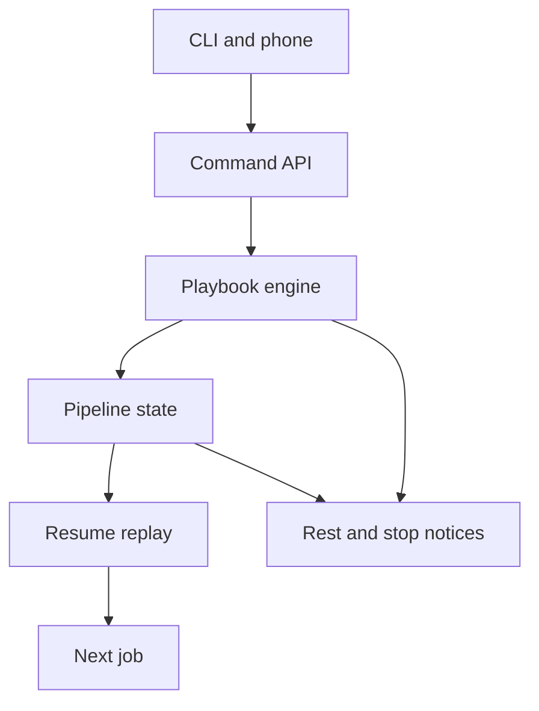

<h3>PR Summary by Qodo</h3>

Preserve and replay next steps across human pauses

<code>🐞 Bug fix</code> <code>✨ Enhancement</code> <code>🧪 Tests</code> <code>📝 Documentation</code> <code>🕐 40+ Minutes</code>

AI Description

<dl>
<dd>
 

><pre>
>• Keep job endings during human pauses so autonomous series can continue after owner work.
></pre>

</dd>
</dl>

Diagram

<dl>
<dd>

 

</dd>
</dl>

High-Level Assessment

<dl>
<dd>

 

>The following are alternative approaches to this PR:

<b>1. Replay from the inbox event log</b>

<dl>
<dd>

- ➕ Could avoid a separate list of retained job endings in pipeline state.
- ➖ Would require durable replay cursors and duplicate-dispatch safeguards.
- ➖ Makes one-ending-per-role replacement and restart behavior harder to reason about.

</dd>
</dl>

>**Recommendation:** Keep the PR&#x27;s bounded, persisted per-role endings: it fits the existing pipeline state and makes resume behavior explicit. Event-log replay is worth considering only if broader event-sourcing requirements emerge.

</dd>
</dl>

 Files changed (26) <code> +2504 / -229 </code> 

<dl>
<dd>

 

Enhancement (4) <code> +49 / -3 </code>

<dl>
<dd>

api.py<code>Enforce human-pause command and hold behavior</code> <code>+21/-2</code>

 

>Enforce human-pause command and hold behavior
>
><pre>
>• Refuses go and consult during a human pause, translates refused resumes into API errors, and checks at rest after denials. Computes a held kit&#x27;s published reason before filing its event.
></pre>
>
><a href='https://github.com/SigorMatt/hands/pull/8/files#diff-16f021e493ba18b1e5f11a7ee4f78300324921ac8ae5a15bbe45cab098c59139'>src/hands/api.py</a>

cli.py<code>Expose kept endings and resume provenance</code> <code>+13/-0</code>

 

>Expose kept endings and resume provenance
>
><pre>
>• Prints retained endings and suppressed stops in pipeline output, and shows resumed_from in job details.
></pre>
>
><a href='https://github.com/SigorMatt/hands/pull/8/files#diff-b53aaafe941dad7529e17dc5ad20b86fb13177f2778fbe0547c019ca0c4c8ce4'>src/hands/cli.py</a>

limits.py<code>Expose scheduled limit resumes</code> <code>+4/-0</code>

 

>Expose scheduled limit resumes
>
><pre>
>• Adds a pending-resume query so at-rest notification waits for scheduled limit recovery.
></pre>
>
><a href='https://github.com/SigorMatt/hands/pull/8/files#diff-f56818881f6e7b40991be9c9d33fdf5544c80847fd32e06d4f8c6b4cb25fe7e2'>src/hands/limits.py</a>

phone.py<code>Show human pauses in phone status</code> <code>+11/-1</code>

 

>Show human pauses in phone status
>
><pre>
>• Names the human pause and lists retained role and job IDs in the phone status summary.
></pre>
>
><a href='https://github.com/SigorMatt/hands/pull/8/files#diff-6d175ae5f33f6b544ecf5e01493181c805135928b88647bc51a3ff9971544b75'>src/hands/phone.py</a>

</dd>
</dl>

Bug fix (5) <code> +529 / -87 </code>

<dl>
<dd>

daemon.py<code>Publish held-kit reasons without blocking the event loop</code> <code>+28/-16</code>

 

>Publish held-kit reasons without blocking the event loop
>
><pre>
>• Moves stored-kit hold-reason decisions to worker threads before filing and during startup. Checks for at rest after queued cancellation and spawn failure.
></pre>
>
><a href='https://github.com/SigorMatt/hands/pull/8/files#diff-2224a4a9fb4a4b1dff488eefd97ff2528609544c0e2c33da2ddf160312fb97d6'>src/hands/daemon.py</a>

doctor.py<code>Use runner environments for live checks</code> <code>+10/-9</code>

 

>Use runner environments for live checks
>
><pre>
>• Builds both ordinary-role and architect live-turn environments through the shared runner decision rather than separate environment assembly.
></pre>
>
><a href='https://github.com/SigorMatt/hands/pull/8/files#diff-3910c7af1fd466f413148b4c6d7df4a5256ce2fe25441aa2ebb485a058b52f18'>src/hands/doctor.py</a>

kit.py<code>Recognize configured playbooks in kit warnings</code> <code>+60/-16</code>

 

>Recognize configured playbooks in kit warnings
>
><pre>
>• Uses the shared playbook-entry test for ownership warnings, including configured repository paths and letter-case variants. Reports which paths can be judged when project configuration is unavailable.
></pre>
>
><a href='https://github.com/SigorMatt/hands/pull/8/files#diff-c741f63d4fccb12bbfc566ee658f6a10d5d610c9e09e4a336f11292aaa5c1b37'>src/hands/kit.py</a>

playbook.py<code>Persist human pauses and replay kept endings</code> <code>+404/-41</code>

 

>Persist human pauses and replay kept endings
>
><pre>
>• Keeps eligible role endings, marks suppressed stops and at-rest publication, and preserves these across restarts. Resume reloads the playbook, refuses unsafe replay, and decides endings until a job starts or the pipeline stops; kit ownership also recognizes configured playbook paths.
></pre>
>
><a href='https://github.com/SigorMatt/hands/pull/8/files#diff-d4c45908377a317f0fbbccad6f8af7a74c4af564c4272d3cecc7126bf1be9204'>src/hands/playbook.py</a>

spool.py<code>Recognize playbook entries and kept-ending events</code> <code>+27/-5</code>

 

>Recognize playbook entries and kept-ending events
>
><pre>
>• Adds case-insensitive matching against configured and fixed playbook paths. Registers kept-replaced and kept-discarded inbox events and applies the matching rule to stored kits.
></pre>
>
><a href='https://github.com/SigorMatt/hands/pull/8/files#diff-afef6fe420dcdc67164710839c508470d94b5a42c23284c4d8cbca7fe9a71221'>src/hands/spool.py</a>

</dd>
</dl>

Refactor (1) <code> +18 / -4 </code>

<dl>
<dd>

runner.py<code>Share job and live-turn environment decisions</code> <code>+18/-4</code>

 

>Share job and live-turn environment decisions
>
><pre>
>• Extracts turn_env from job_env so doctor receives the same role-specific environment without inheriting HANDS_JOB.
></pre>
>
><a href='https://github.com/SigorMatt/hands/pull/8/files#diff-33639dfe2ec751f3319053b79320b1fb736bb2a8eac7a7082ae582f76782cf54'>src/hands/runner.py</a>

</dd>
</dl>

Tests (8) <code> +1535 / -31 </code>

<dl>
<dd>

test_consult.py<code>Preserve consult tests for non-human stops</code> <code>+4/-4</code>

 

>Preserve consult tests for non-human stops
>
><pre>
>• Changes existing consult scenarios to stop the engine directly, since a human pause now refuses consult.
></pre>
>
><a href='https://github.com/SigorMatt/hands/pull/8/files#diff-7131a9d0f5d0c3b813bf1bc7a3386bd4956b37878d1fab73bf9d531768d9d2ea'>tests/test_consult.py</a>

test_doctor.py<code>Test live-turn background-task environments</code> <code>+31/-0</code>

 

>Test live-turn background-task environments
>
><pre>
>• Checks builder, aux, and architect live turns with installed and stale background-task hooks.
></pre>
>
><a href='https://github.com/SigorMatt/hands/pull/8/files#diff-fade675e2c090faef5c26627755d9d4b80a5a3345b23b9573ff45493af4bb1ca'>tests/test_doctor.py</a>

test_human_pause.py<code>Exercise human-pause lifecycle and replay</code> <code>+1023/-0</code>

 

>Exercise human-pause lifecycle and replay
>
><pre>
>• Adds engine and daemon coverage for retained endings, restart, refusals, suppressed stops, replay, and at-rest notifications. Also checks CLI and phone visibility and cancellation or denial paths.
></pre>
>
><a href='https://github.com/SigorMatt/hands/pull/8/files#diff-e74b0be072818af0225c5ac52ee6aa88a586903a25919c7e7bf0d34f8760d2ca'>tests/test_human_pause.py</a>

test_kit.py<code>Test configured and case-varied kit warnings</code> <code>+105/-0</code>

 

>Test configured and case-varied kit warnings
>
><pre>
>• Verifies ownership warnings for fixed and configured playbook paths in different letter cases, with and without project configuration.
></pre>
>
><a href='https://github.com/SigorMatt/hands/pull/8/files#diff-b3958ae2feb00d9e16b26db0a3af497629df71b4db8d583f8178a4c74fa901d3'>tests/test_kit.py</a>

test_operator_table.py<code>Require published titles at row starts</code> <code>+81/-14</code>

 

>Require published titles at row starts
>
><pre>
>• Makes the handbook coverage reader match titles only against a row&#x27;s leading titles. Adds regressions for one-word titles and adjusts the held-reason exemption.
></pre>
>
><a href='https://github.com/SigorMatt/hands/pull/8/files#diff-9cb3db68dbfe38e0f721592b1254b54bbead87e66798bf88ee11c1c23175e922'>tests/test_operator_table.py</a>

test_phone.py<code>Test phone refusals under human pauses</code> <code>+49/-2</code>

 

>Test phone refusals under human pauses
>
><pre>
>• Checks phone status and titled go, consult, and resume refusals while an ending is kept. Moves older stopped-pipeline tests to non-human stops.
></pre>
>
><a href='https://github.com/SigorMatt/hands/pull/8/files#diff-1ab2e74caabf626cc62c44917bc5256134d853d258c94ca530d29bc4486e89b3'>tests/test_phone.py</a>

test_playbook.py<code>Test ownership and nonblocking hold reasons</code> <code>+240/-10</code>

 

>Test ownership and nonblocking hold reasons
>
><pre>
>• Adds configured-path and letter-case ownership tests and verifies held-kit zip reads run off the event loop. Adjusts existing pause tests for at-rest notices and non-human-stop behavior.
></pre>
>
><a href='https://github.com/SigorMatt/hands/pull/8/files#diff-00966bca5744c3edcaf16252d9a9e5dbe092f5f76422c5357077b91f27f001dc'>tests/test_playbook.py</a>

test_wake.py<code>Cover new pipeline inbox events</code> <code>+2/-1</code>

 

>Cover new pipeline inbox events
>
><pre>
>• Updates the pipeline event-group expectation to include kept-replaced and kept-discarded events.
></pre>
>
><a href='https://github.com/SigorMatt/hands/pull/8/files#diff-5866f575119d8ad6c400f4d7f72a32cb112beb1eccb967ce3957e419df61d045'>tests/test_wake.py</a>

</dd>
</dl>

Documentation (8) <code> +373 / -104 </code>

<dl>
<dd>

ARCHITECT-HANDBOOK.md<code>Document human pauses and operator responses</code> <code>+44/-2</code>

 

>Document human pauses and operator responses
>
><pre>
>• Explains kept endings, at-rest notifications, owner commits, and resume. Adds operator-table rows for new notifications and command refusals.
></pre>
>
><a href='https://github.com/SigorMatt/hands/pull/8/files#diff-2ad26343d21a57c4b0e1450bc61bad64fd9ee975037b345cdcf9841cdab2905e'>docs/ARCHITECT-HANDBOOK.md</a>

OPERATIONS.md<code>Add the quiet-moment operating procedure</code> <code>+22/-1</code>

 

>Add the quiet-moment operating procedure
>
><pre>
>• Documents how to pause, wait for at rest, commit owner work, and resume. Identifies the new pause state as must-carry data in pipeline.json.
></pre>
>
><a href='https://github.com/SigorMatt/hands/pull/8/files#diff-3b441db82a6aa05a4005032fb6541cc4719b4ef8308cb78ddcfcb80a6da0bf91'>docs/OPERATIONS.md</a>

PLAYBOOK.md<code>Specify human-pause playbook behavior</code> <code>+47/-2</code>

 

>Specify human-pause playbook behavior
>
><pre>
>• Distinguishes human pauses from other stops and describes kept endings, suppressed stops, at rest, and replay on resume.
></pre>
>
><a href='https://github.com/SigorMatt/hands/pull/8/files#diff-2caab8322fd895d19c2c0aeb1e9d4d48abe9a134afd0ade65bdb75b661a8eff0'>docs/PLAYBOOK.md</a>

CHECKPOINT.md<code>Record mission 28 progress and remaining limits</code> <code>+54/-51</code>

 

>Record mission 28 progress and remaining limits
>
><pre>
>• Replaces the previous mission checkpoint with unit outcomes, test counts, unresolved coverage, and standing constraints.
></pre>
>
><a href='https://github.com/SigorMatt/hands/pull/8/files#diff-ea6fe37f51c315b66c5f700d302e82876099d5e56dca9614d58d4db344903b78'>meta/CHECKPOINT.md</a>

FINAL-REPORT-28.md<code>Report mission 28 implementation and evidence</code> <code>+128/-0</code>

 

>Report mission 28 implementation and evidence
>
><pre>
>• Summarizes each unit, test evidence, unproven scenarios, deviations, and dispositions of prior review items.
></pre>
>
><a href='https://github.com/SigorMatt/hands/pull/8/files#diff-4f07945ac9cfe205673bf957deee3127171035a5dd177872168754202d5b3377'>meta/FINAL-REPORT-28.md</a>

FINDINGS.md<code>Resolve playbook-path and pause findings</code> <code>+37/-1</code>

 

>Resolve playbook-path and pause findings
>
><pre>
>• Records the cause and resolution of dropped next steps under human pauses and closes the case-insensitive playbook-entry finding.
></pre>
>
><a href='https://github.com/SigorMatt/hands/pull/8/files#diff-15d0d274f2f7c3edd933310939b6c0581b53648f48d23f2039cca510e9aa21cd'>meta/findings/FINDINGS.md</a>

journal.md<code>Log mission 28 unit outcomes</code> <code>+6/-0</code>

 

>Log mission 28 unit outcomes
>
><pre>
>• Appends unit-by-unit implementation, test, and coverage notes.
></pre>
>
><a href='https://github.com/SigorMatt/hands/pull/8/files#diff-9f0a1b37813ca47db6195fa5c6e69a32efcef6da121060bbd5f1d558be1cbeda'>meta/journal.md</a>

plan.md<code>Replace the mission plan</code> <code>+35/-47</code>

 

>Replace the mission plan
>
><pre>
>• Defines mission 28 units and dependencies covering human pauses, documentation, review fixes, and kit ownership.
></pre>
>
><a href='https://github.com/SigorMatt/hands/pull/8/files#diff-7b1c6ea9ab4fd6179a8304348a94fbf1fa61cfb6aafed7ec549bcd7b7f8df461'>meta/plan.md</a>

</dd>
</dl>

</dd>
</dl>

