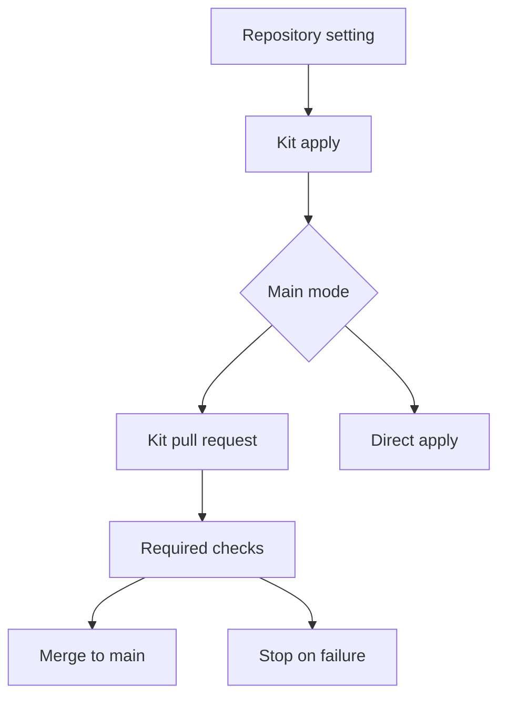

<h3>PR Summary by Qodo</h3>

Support CI-gated pull requests for changes to main

<code>✨ Enhancement</code> <code>🐞 Bug fix</code> <code>🧪 Tests</code> <code>📝 Documentation</code> <code>⚙️ Configuration changes</code> <code>🕐 40+ Minutes</code>

AI Description

<dl>
<dd>
 

><pre>
>• Add a configurable pull-request workflow for kit applies while retaining direct mode.
>• Wait for required CI checks and stop unsuccessful applies before ordinary playbook rules.
>• Adapt mission reviews, diagnostics, and operator guidance for protected main branches.
></pre>

</dd>
</dl>

Diagram

<dl>
<dd>

 

</dd>
</dl>

High-Level Assessment

<dl>
<dd>

 

>The following are alternative approaches to this PR:

<b>1. Orchestrate kit pull requests in handsd</b>

<dl>
<dd>

- ➕ Make branch, check, and merge transitions mechanically enforceable.
- ➕ Reduce reliance on a builder following a long prompt.
- ➖ Require authenticated GitHub writes and substantial daemon state management.
- ➖ Increase migration and recovery complexity beyond this mission&#x27;s scope.

</dd>
</dl>

>**Recommendation:** Keep the incremental prompt-based approach: it preserves direct mode and limits hands&#x27; new GitHub access to reads. Follow up with a real end-to-end apply and review under an enabled ruleset; the report explicitly says those paths are not yet proven.

</dd>
</dl>

 Files changed (46) <code> +4183 / -258 </code> 

<dl>
<dd>

 

Enhancement (7) <code> +639 / -37 </code>

<dl>
<dd>

api.py<code>Use configured mode for API-filed applies</code> <code>+7/-2</code>

 

>Use configured mode for API-filed applies
>
><pre>
>• Passes the repository&#x27;s main setting when constructing apply prompts for stored kits.
></pre>
>
><a href='https://github.com/SigorMatt/hands/pull/9/files#diff-16f021e493ba18b1e5f11a7ee4f78300324921ac8ae5a15bbe45cab098c59139'>src/hands/api.py</a>

cli.py<code>Add hands ci-wait</code> <code>+112/-1</code>

 

>Add hands ci-wait
>
><pre>
>• Adds bounded polling of required PR checks with distinct passed, failed, waiting, and error exit codes.
></pre>
>
><a href='https://github.com/SigorMatt/hands/pull/9/files#diff-b53aaafe941dad7529e17dc5ad20b86fb13177f2778fbe0547c019ca0c4c8ce4'>src/hands/cli.py</a>

doctor.py<code>Diagnose main&#x27;s effective rules</code> <code>+64/-1</code>

 

>Diagnose main&#x27;s effective rules
>
><pre>
>• Adds a non-failing diagnostic row comparing the configured mode with GitHub rules and warning about incompatible merge rules.
></pre>
>
><a href='https://github.com/SigorMatt/hands/pull/9/files#diff-3910c7af1fd466f413148b4c6d7df4a5256ce2fe25441aa2ebb485a058b52f18'>src/hands/doctor.py</a>

forge.py<code>Share read-only GitHub access</code> <code>+191/-0</code>

 

>Share read-only GitHub access
>
><pre>
>• Adds origin parsing and gh reads for authentication, effective branch rules, PR branches, and reported checks.
></pre>
>
><a href='https://github.com/SigorMatt/hands/pull/9/files#diff-42c2bbf35e294e07442c894cf38bb51e3ba24a08ed0a80fe6eab3fce7b6d6117'>src/hands/forge.py</a>

kit.py<code>Prepare resumable pull-request kit applies</code> <code>+229/-30</code>

 

>Prepare resumable pull-request kit applies
>
><pre>
>• Builds mode-specific prompts and content-derived kit branch names, reports kit hashes, and warns when a kit carries CI files.
></pre>
>
><a href='https://github.com/SigorMatt/hands/pull/9/files#diff-c741f63d4fccb12bbfc566ee658f6a10d5d610c9e09e4a336f11292aaa5c1b37'>src/hands/kit.py</a>

phone.py<code>Use configured mode for phone kits</code> <code>+4/-1</code>

 

>Use configured mode for phone kits
>
><pre>
>• Constructs phone-filed kit applies with the project&#x27;s selected main workflow.
></pre>
>
><a href='https://github.com/SigorMatt/hands/pull/9/files#diff-6d175ae5f33f6b544ecf5e01493181c805135928b88647bc51a3ff9971544b75'>src/hands/phone.py</a>

spool.py<code>Identify CI files in stored kits</code> <code>+32/-2</code>

 

>Identify CI files in stored kits
>
><pre>
>• Recognizes .github entries and scripts/check case-insensitively and exposes matching entries from stored kit zips.
></pre>
>
><a href='https://github.com/SigorMatt/hands/pull/9/files#diff-afef6fe420dcdc67164710839c508470d94b5a42c23284c4d8cbca7fe9a71221'>src/hands/spool.py</a>

</dd>
</dl>

Bug fix (2) <code> +166 / -29 </code>

<dl>
<dd>

limits.py<code>Preserve apply prompts after usage limits</code> <code>+5/-3</code>

 

>Preserve apply prompts after usage limits
>
><pre>
>• Resends the original apply prompt for limited builder applies instead of the general builder resume line.
></pre>
>
><a href='https://github.com/SigorMatt/hands/pull/9/files#diff-f56818881f6e7b40991be9c9d33fdf5544c80847fd32e06d4f8c6b4cb25fe7e2'>src/hands/limits.py</a>

playbook.py<code>Protect failed applies and paused state</code> <code>+161/-26</code>

 

>Protect failed applies and paused state
>
><pre>
>• Stops unsuccessful applies before ordinary rules, holds role-filed CI-changing kits for a human, preserves apply prompts across resumes, and republishes changed at-rest lists.
></pre>
>
><a href='https://github.com/SigorMatt/hands/pull/9/files#diff-d4c45908377a317f0fbbccad6f8af7a74c4af564c4272d3cecc7126bf1be9204'>src/hands/playbook.py</a>

</dd>
</dl>

Refactor (1) <code> +3 / -10 </code>

<dl>
<dd>

daemon.py<code>Share apply resume-chain identification</code> <code>+3/-10</code>

 

>Share apply resume-chain identification
>
><pre>
>• Uses the playbook&#x27;s chain walker to identify applies across resumed jobs and clarifies restart-time at-rest behavior.
></pre>
>
><a href='https://github.com/SigorMatt/hands/pull/9/files#diff-2224a4a9fb4a4b1dff488eefd97ff2528609544c0e2c33da2ddf160312fb97d6'>src/hands/daemon.py</a>

</dd>
</dl>

Documentation (14) <code> +758 / -132 </code>

<dl>
<dd>

CLAUDE.md<code>Clarify when main accepts direct commits</code> <code>+3/-1</code>

 

>Clarify when main accepts direct commits
>
><pre>
>• Limits the documented direct plan and review commits to repositories configured for direct mode.
></pre>
>
><a href='https://github.com/SigorMatt/hands/pull/9/files#diff-6ebdb617a8104a7756d0cf36578ab01103dc9f07e4dc6feb751296b9c402faf7'>CLAUDE.md</a>

CLAUDE.md<code>Guide architects working with protected main</code> <code>+12/-2</code>

 

>Guide architects working with protected main
>
><pre>
>• Explains where to read branch-resident blocker reviews and requires kits to preserve the CI gate unless the owner requests changes.
></pre>
>
><a href='https://github.com/SigorMatt/hands/pull/9/files#diff-c7481d712d315e34b3da6aac27aaebe24ec06bb80ebb35f3c1c5e073b561920e'>architect/CLAUDE.md</a>

ARCHITECT-HANDBOOK.md<code>Document pull-request applies and operations</code> <code>+166/-3</code>

 

>Document pull-request applies and operations
>
><pre>
>• Adds the kit apply workflow, review and migration guidance, ci-wait reference, and operator responses for failed applies and CI-owning kits.
></pre>
>
><a href='https://github.com/SigorMatt/hands/pull/9/files#diff-2ad26343d21a57c4b0e1450bc61bad64fd9ee975037b345cdcf9841cdab2905e'>docs/ARCHITECT-HANDBOOK.md</a>

INTEGRATION.md<code>Explain repository configuration and diagnostics</code> <code>+32/-1</code>

 

>Explain repository configuration and diagnostics
>
><pre>
>• Documents the main setting, GitHub authentication needs, and doctor&#x27;s comparison with effective branch rules.
></pre>
>
><a href='https://github.com/SigorMatt/hands/pull/9/files#diff-9610d0a1913600337b4a1fb10a0a3ca941655e61137a7e2ee493dfec6c622d99'>docs/INTEGRATION.md</a>

OPERATIONS.md<code>Add the protected-main migration runbook</code> <code>+34/-1</code>

 

>Add the protected-main migration runbook
>
><pre>
>• Describes the quiet-moment switch, rollback order, and use of a decisions kit for changes made while paused.
></pre>
>
><a href='https://github.com/SigorMatt/hands/pull/9/files#diff-3b441db82a6aa05a4005032fb6541cc4719b4ef8308cb78ddcfcb80a6da0bf91'>docs/OPERATIONS.md</a>

PLAYBOOK.md<code>Document apply stops and at-rest updates</code> <code>+24/-3</code>

 

>Document apply stops and at-rest updates
>
><pre>
>• Explains why an apply that did not land bypasses playbook rules and when a changed kept list republishes at rest.
></pre>
>
><a href='https://github.com/SigorMatt/hands/pull/9/files#diff-2caab8322fd895d19c2c0aeb1e9d4d48abe9a134afd0ade65bdb75b661a8eff0'>docs/PLAYBOOK.md</a>

CHECKPOINT.md<code>Record mission 29 progress</code> <code>+65/-55</code>

 

>Record mission 29 progress
>
><pre>
>• Replaces the previous mission&#x27;s checkpoint with unit outcomes, test counts, remaining work, and constraints.
></pre>
>
><a href='https://github.com/SigorMatt/hands/pull/9/files#diff-ea6fe37f51c315b66c5f700d302e82876099d5e56dca9614d58d4db344903b78'>meta/CHECKPOINT.md</a>

FINAL-REPORT-29.md<code>Report mission 29 implementation and limits</code> <code>+120/-0</code>

 

>Report mission 29 implementation and limits
>
><pre>
>• Summarizes completed units, test evidence, deviations, and behavior not yet demonstrated against a real protected repository.
></pre>
>
><a href='https://github.com/SigorMatt/hands/pull/9/files#diff-db77fd6ebfbe7af744a3bb5628bb16cc950ff115db7d257438e72af64d6e0033'>meta/FINAL-REPORT-29.md</a>

REVIEW-PROTOCOL.md<code>Adapt this repository&#x27;s review protocol</code> <code>+86/-10</code>

 

>Adapt this repository&#x27;s review protocol
>
><pre>
>• Requires a GitHub rules read, CI waits around review commits, and branch-resident reviews when main requires pull requests.
></pre>
>
><a href='https://github.com/SigorMatt/hands/pull/9/files#diff-d136b4ee2cca075a1117349d23c7a4be93a3bd39bc5aaad31471473f17afa8cf'>meta/REVIEW-PROTOCOL.md</a>

FINDINGS.md<code>Resolve apply-stop and at-rest findings</code> <code>+51/-0</code>

 

>Resolve apply-stop and at-rest findings
>
><pre>
>• Records H-079 and H-080, their observed failure modes, and the units that resolve them.
></pre>
>
><a href='https://github.com/SigorMatt/hands/pull/9/files#diff-15d0d274f2f7c3edd933310939b6c0581b53648f48d23f2039cca510e9aa21cd'>meta/findings/FINDINGS.md</a>

journal.md<code>Log mission 29 units</code> <code>+8/-0</code>

 

>Log mission 29 units
>
><pre>
>• Appends unit-by-unit implementation, gate results, and unproven behavior.
></pre>
>
><a href='https://github.com/SigorMatt/hands/pull/9/files#diff-9f0a1b37813ca47db6195fa5c6e69a32efcef6da121060bbd5f1d558be1cbeda'>meta/journal.md</a>

plan.md<code>Plan the protected-main mission</code> <code>+44/-38</code>

 

>Plan the protected-main mission
>
><pre>
>• Replaces mission 28&#x27;s plan with the CI, configuration, apply, review, and at-rest units for mission 29.
></pre>
>
><a href='https://github.com/SigorMatt/hands/pull/9/files#diff-7b1c6ea9ab4fd6179a8304348a94fbf1fa61cfb6aafed7ec549bcd7b7f8df461'>meta/plan.md</a>

BUILDER-N-PROMPT.md<code>Prepare builders for protected-main missions</code> <code>+27/-8</code>

 

>Prepare builders for protected-main missions
>
><pre>
>• Adds CI waiting, branch-safe journal handling, and a prohibition on direct missions when main requires pull requests.
></pre>
>
><a href='https://github.com/SigorMatt/hands/pull/9/files#diff-4abca313f3571f857a4d82f471a44d49fcb38a568dba8775b9e3aa7e82e30dca'>templates/BUILDER-N-PROMPT.md</a>

REVIEW-PROTOCOL.md<code>Gate template reviews and merges on CI</code> <code>+86/-10</code>

 

>Gate template reviews and merges on CI
>
><pre>
>• Makes reviews inspect main&#x27;s rules, wait for checks, commit protected-main reviews to mission branches, and block unmerged clean verdicts.
></pre>
>
><a href='https://github.com/SigorMatt/hands/pull/9/files#diff-1a13ad1e2168d9dd38e2e3f07712fc77e6d7bbef5b55f45f54dbd1737103bfb6'>templates/REVIEW-PROTOCOL.md</a>

</dd>
</dl>

Other (22) <code> +2617 / -50 </code>

<dl>
<dd>

check.yml<code>Run the check gate on GitHub</code> <code>+27/-0</code>

 

>Run the check gate on GitHub
>
><pre>
>• Adds a SHA-pinned workflow running ./scripts/check for pull requests and pushes to main, with bounded execution and per-ref concurrency.
></pre>
>
><a href='https://github.com/SigorMatt/hands/pull/9/files#diff-55f05888fd854d9962bdd4d8ccf23a07b610990f58174397b2586b58f8937428'>.github/workflows/check.yml</a>

config.py<code>Configure how main moves</code> <code>+28/-1</code>

 

>Configure how main moves
>
><pre>
>• Adds a repository.main setting that defaults to direct and accepts only direct or pull-request.
></pre>
>
><a href='https://github.com/SigorMatt/hands/pull/9/files#diff-bee58eb7fec766fa3b7a3615f745a974c94fd209b85d819fc80e50315ea5dd93'>src/hands/config.py</a>

config.toml<code>Show the optional repository setting</code> <code>+7/-0</code>

 

>Show the optional repository setting
>
><pre>
>• Documents the direct default and the pull-request option in the config template.
></pre>
>
><a href='https://github.com/SigorMatt/hands/pull/9/files#diff-1b64e2c1007a5d62832e86f3c8c473eb13d874164b89d15fd4dbac80fb24b11f'>templates/config.toml</a>

conftest.py<code>Keep network tests local and wheel builds offline</code> <code>+48/-0</code>

 

>Keep network tests local and wheel builds offline
>
><pre>
>• Adds an autouse off-machine proxy fixture and a wheel-build helper that skips only when the offline backend is absent.
></pre>
>
><a href='https://github.com/SigorMatt/hands/pull/9/files#diff-e52e4ddd58b7ef887ab03c04116e676f6280b824ab7469d5d3080e5cba4f2128'>tests/conftest.py</a>

fake_gh.py<code>Simulate GitHub rules and PR checks</code> <code>+76/-1</code>

 

>Simulate GitHub rules and PR checks
>
><pre>
>• Extends the gh stand-in with effective rules, PR metadata, check responses, authentication failures, and call logging.
></pre>
>
><a href='https://github.com/SigorMatt/hands/pull/9/files#diff-7c666a3b82b131a6a539c5a71caa5902d487d149c75baee27bd9834f43220b47'>tests/fake_gh.py</a>

test_apply_not_landed.py<code>Exercise apply-stop and CI-ownership rules</code> <code>+510/-0</code>

 

>Exercise apply-stop and CI-ownership rules
>
><pre>
>• Covers unsuccessful applies across resume and pause states, CI-file holds and warnings, and branch-safe journal wording.
></pre>
>
><a href='https://github.com/SigorMatt/hands/pull/9/files#diff-75fd6ebd2bdcd0692323a9e9ac2460701097788001a3c31ce33bca1f92b9de3c'>tests/test_apply_not_landed.py</a>

test_apply_shape.py<code>Verify mode-specific apply prompts and resumes</code> <code>+448/-0</code>

 

>Verify mode-specific apply prompts and resumes
>
><pre>
>• Pins prompt text, content-derived branches and hashes, kit check output, and kickoff behavior after a resumed apply lands.
></pre>
>
><a href='https://github.com/SigorMatt/hands/pull/9/files#diff-5fd910485996cf07749dd89b3e2384cfbe22407c5b1752eed8903c1618acc46d'>tests/test_apply_shape.py</a>

test_bash_guard.py<code>Check architect access to branch reviews</code> <code>+22/-0</code>

 

>Check architect access to branch reviews
>
><pre>
>• Verifies the documented git show form is allowed while the alternate fetch form remains guarded.
></pre>
>
><a href='https://github.com/SigorMatt/hands/pull/9/files#diff-4bed1c89964adf4a3a3fe55e295ac969a3393da5d499782e5a1c9af10e8992e8'>tests/test_bash_guard.py</a>

test_ci.py<code>Pin workflow and network-isolation behavior</code> <code>+71/-0</code>

 

>Pin workflow and network-isolation behavior
>
><pre>
>• Checks workflow triggers, job name, SHA-pinned actions, execution bounds, and refusal of off-machine HTTP requests.
></pre>
>
><a href='https://github.com/SigorMatt/hands/pull/9/files#diff-707fb81cab195410b4951c7156b6a9e077bf95fbc00fc186591da117bf4c8043'>tests/test_ci.py</a>

test_ci_wait.py<code>Cover required-check polling outcomes</code> <code>+433/-0</code>

 

>Cover required-check polling outcomes
>
><pre>
>• Tests origin formats, GitHub read failures, check selection, polling deadlines, CLI output, and all exit statuses.
></pre>
>
><a href='https://github.com/SigorMatt/hands/pull/9/files#diff-36b7a4554465cfd4b0a4732939dec54773485e077f026a2d7d9c98ee7ed82e0d'>tests/test_ci_wait.py</a>

test_config.py<code>Test repository.main validation</code> <code>+42/-1</code>

 

>Test repository.main validation
>
><pre>
>• Covers defaults, accepted values, rejected values and keys, whitespace normalization, and the config template.
></pre>
>
><a href='https://github.com/SigorMatt/hands/pull/9/files#diff-da24b355349b53e4c8047034767d008e4c2ce9ea6c8933a3acd50d0828f00528'>tests/test_config.py</a>

test_docs.py<code>Recognize new documented commands</code> <code>+12/-6</code>

 

>Recognize new documented commands
>
><pre>
>• Updates command and convention assertions for ci-wait, additional gh operations, and mode-dependent main commits.
></pre>
>
><a href='https://github.com/SigorMatt/hands/pull/9/files#diff-5c6dddc0c85981eb75bdb49d400e82c9271918e138990baba53ac34cbcf2aaac'>tests/test_docs.py</a>

test_docs_45.py<code>Pin protected-main instructions across documents</code> <code>+448/-0</code>

 

>Pin protected-main instructions across documents
>
><pre>
>• Checks the review protocols, builder and architect instructions, handbook, and runbooks for the new workflow and ordering.
></pre>
>
><a href='https://github.com/SigorMatt/hands/pull/9/files#diff-23cc26d9a9059fac4d8b4b4fba07516cb5d26b20b9f240270e440ead372caa42'>tests/test_docs_45.py</a>

test_doctor.py<code>Test main diagnostics without external notifications</code> <code>+228/-2</code>

 

>Test main diagnostics without external notifications
>
><pre>
>• Moves live architect notifications to a local stub and covers doctor&#x27;s rule agreement, warnings, and skipped reads.
></pre>
>
><a href='https://github.com/SigorMatt/hands/pull/9/files#diff-fade675e2c090faef5c26627755d9d4b80a5a3345b23b9573ff45493af4bb1ca'>tests/test_doctor.py</a>

test_handbook.py<code>Use the shared offline wheel builder</code> <code>+2/-11</code>

 

>Use the shared offline wheel builder
>
><pre>
>• Keeps the installed-handbook test offline while allowing a skip when hatchling is not cached.
></pre>
>
><a href='https://github.com/SigorMatt/hands/pull/9/files#diff-7b18bfb854d4bd695c05bcd4fea94ac6aab1829e82e0b5b13a533767c458f546'>tests/test_handbook.py</a>

test_human_pause.py<code>Test at-rest republication after kept changes</code> <code>+82/-4</code>

 

>Test at-rest republication after kept changes
>
><pre>
>• Covers newly kept and replaced ends, busy pipelines, and restart behavior when a change has not yet been published.
></pre>
>
><a href='https://github.com/SigorMatt/hands/pull/9/files#diff-e74b0be072818af0225c5ac52ee6aa88a586903a25919c7e7bf0d34f8760d2ca'>tests/test_human_pause.py</a>

test_kit.py<code>Test kit-file prompts in pull-request mode</code> <code>+59/-1</code>

 

>Test kit-file prompts in pull-request mode
>
><pre>
>• Verifies the stored zip hash, configured apply prompt, and kit check output agree.
></pre>
>
><a href='https://github.com/SigorMatt/hands/pull/9/files#diff-b3958ae2feb00d9e16b26db0a3af497629df71b4db8d583f8178a4c74fa901d3'>tests/test_kit.py</a>

test_no_background.py<code>Reuse offline wheel-build setup</code> <code>+3/-10</code>

 

>Reuse offline wheel-build setup
>
><pre>
>• Switches the packaged-hook assertion to the shared offline wheel helper.
></pre>
>
><a href='https://github.com/SigorMatt/hands/pull/9/files#diff-c238c456789dcab727e6142c277049c44dc663c9b04a4982b5436ed7a01889fa'>tests/test_no_background.py</a>

test_operations.py<code>Test CLI-filed pull-request applies</code> <code>+31/-0</code>

 

>Test CLI-filed pull-request applies
>
><pre>
>• Checks that hands kit apply files a held job with the configured prompt and copied zip hash.
></pre>
>
><a href='https://github.com/SigorMatt/hands/pull/9/files#diff-1aa04b3ddd9ae5c8201617165caa391614aa6857fe6bda08ebe2b071b5ab28f8'>tests/test_operations.py</a>

test_operator_table.py<code>Pin new operator-facing reasons</code> <code>+7/-1</code>

 

>Pin new operator-facing reasons
>
><pre>
>• Extends operator-table checks for unsuccessful applies and human holds of CI-changing kits.
></pre>
>
><a href='https://github.com/SigorMatt/hands/pull/9/files#diff-9cb3db68dbfe38e0f721592b1254b54bbead87e66798bf88ee11c1c23175e922'>tests/test_operator_table.py</a>

test_phone.py<code>Test phone-filed pull-request applies</code> <code>+31/-0</code>

 

>Test phone-filed pull-request applies
>
><pre>
>• Verifies a phone kit&#x27;s held job uses the configured prompt, stored zip hash, and kit check&#x27;s output.
></pre>
>
><a href='https://github.com/SigorMatt/hands/pull/9/files#diff-1ab2e74caabf626cc62c44917bc5256134d853d258c94ca530d29bc4486e89b3'>tests/test_phone.py</a>

test_project_add.py<code>Reuse offline wheel-build setup</code> <code>+2/-12</code>

 

>Reuse offline wheel-build setup
>
><pre>
>• Switches the packaged project-add file test to the shared offline wheel helper.
></pre>
>
><a href='https://github.com/SigorMatt/hands/pull/9/files#diff-436f3fb29718e33bed1cfb13f85f213b3cef9d5b27c34cfa39497277a8efbbec'>tests/test_project_add.py</a>

</dd>
</dl>

</dd>
</dl>

